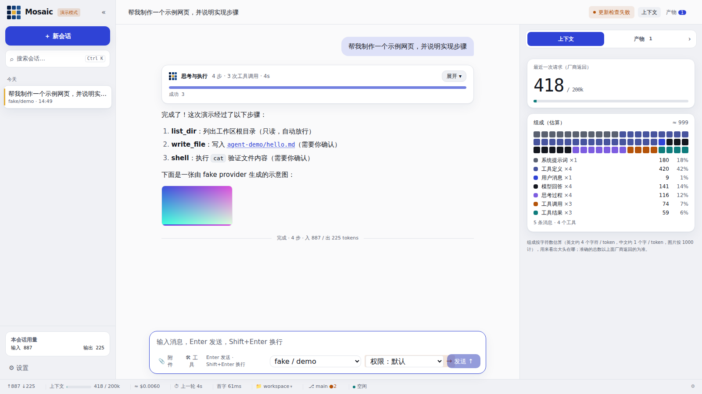
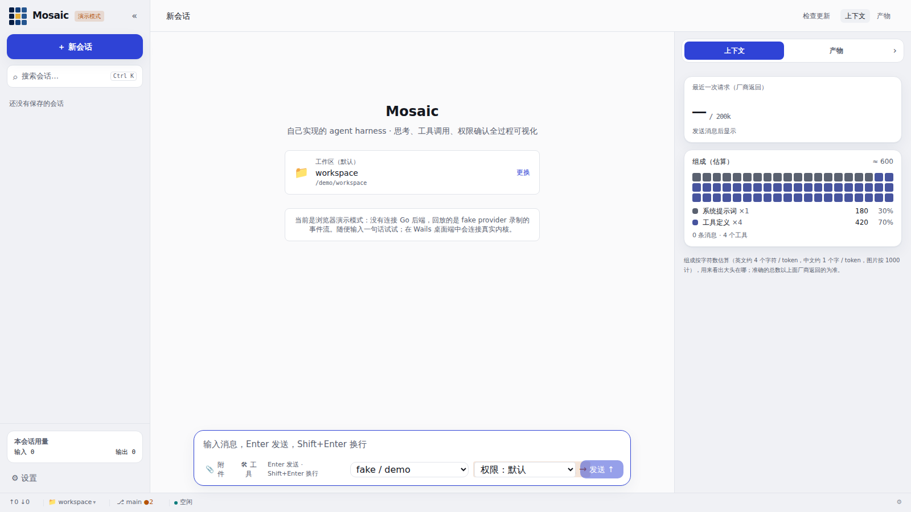
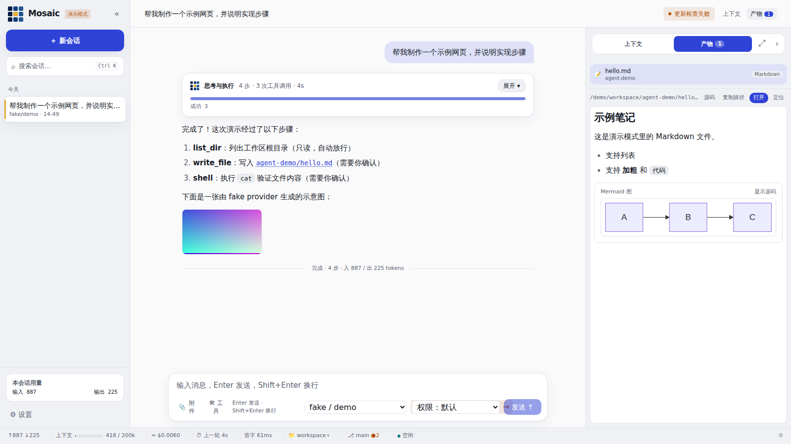
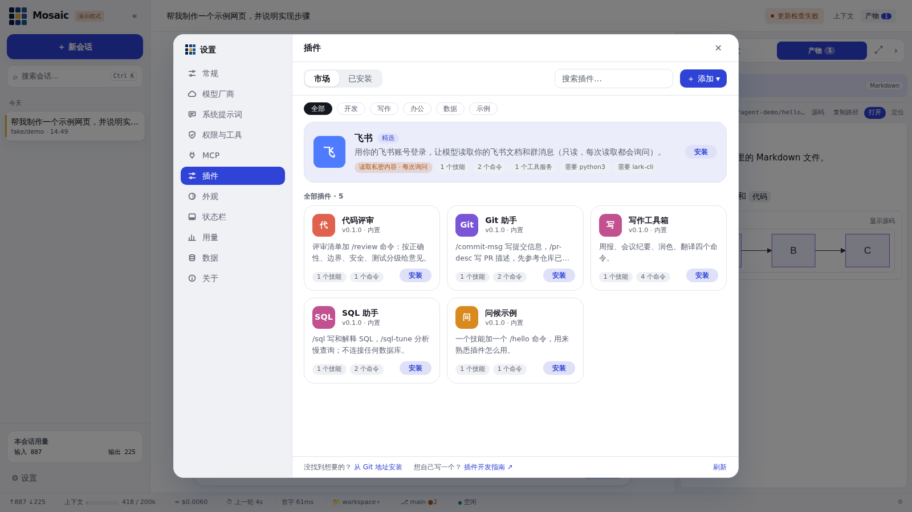
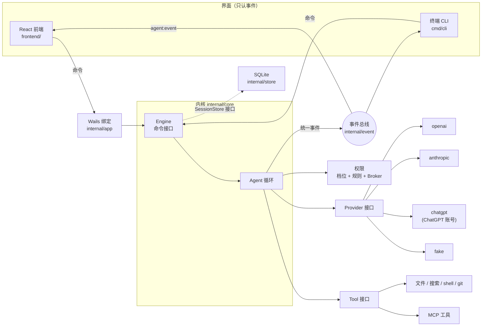

<div align="center">


# Mosaic

**本地优先的 AI 编码工作台。**

在桌面上连接自己的大模型，让 Agent 围绕代码工作区阅读、编辑、执行工具；思考与执行可以展开查看，敏感操作由你决定。

[](LICENSE)
[](go.mod)
[](https://wails.io)
[](frontend/package.json)
[](https://github.com/crazyjums/mosaic/releases/latest)

[下载安装](#下载安装) · [运行界面](#运行界面) · [功能概览](#功能概览) · [快速开始](#快速开始) · [使用手册](docs/usage.md) · [架构设计](docs/architecture.md) · [更新日志](CHANGELOG.md) · [反馈问题](https://github.com/crazyjums/mosaic/issues)

</div>



> **截图说明**：图片由当前 React 前端的浏览器演示模式自动截取，使用离线 fake Provider 和示例数据，不涉及真实账号、API Key 或用户文件。界面结构与桌面版共用；浏览器演示本身不代表真实模型、MCP 服务或系统权限已经连接。文档功能基于 **v1.7.9（2026-11-01）** 核对；后续版本以 [最新 Release](https://github.com/crazyjums/mosaic/releases/latest) 和 [更新日志](CHANGELOG.md) 为准。

## 为什么做 Mosaic

Mosaic 不只是给模型提供一个聊天框，而是尝试把 **Agent 循环、模型适配、工具、上下文、权限和执行结果** 做成可以看见、理解和控制的桌面工作台。

底层 Agent 内核由项目自行实现，不依赖外部 Agent SDK。Go 内核、Wails 桌面端和 CLI 共享统一的执行模型及事件协议；React 前端负责展示会话、任务过程、产物及状态。

名字来自马赛克：不同模型、技能、MCP 工具和界面模块可以拼在一起，也可以逐步替换。

## 功能概览

| 能力 | 已实现的功能 |
| --- | --- |
| **Agent 编码对话** | 流式回复、思考摘要与折叠详情、连续工具调用、权限确认、取消与最大步数保护 |
| **多会话和队列** | 多个会话独立运行；同一会话忙碌时新消息进入队列，可调整顺序或移除 |
| **模型与账号** | OpenAI 兼容接口、Anthropic 原生接口、ChatGPT 账号登录；模型切换、模型组故障转移、网络代理和用量统计 |
| **工作区与产物** | 工作区选择、图片/文本附件、文件与图表预览（HTML、SVG、Markdown、Mermaid、Graphviz 等） |
| **上下文** | 分组用量估算、上下文明细与占用可视化、可配置的自动压缩 |
| **插件 / Skill / MCP** | 插件市场、文件夹/ZIP/Git 安装、斜杠命令、MCP 连接及工具注册、插件健康诊断与重连 |
| **Git 与状态栏** | Git 分支、历史及只读 diff 窗口；可配置的状态项、模型额度、脚本输出 |
| **界面与更新** | 深浅主题、多套内置皮肤、中英文界面、签名校验的更新检查和新版本提示 |

### 模型与登录：两条链路不能混淆

- **API 模型**：在 **设置 → 模型厂商** 中配置 OpenAI 兼容服务或 Anthropic API。自定义服务通常需要 Base URL、API Key 和模型名。
- **ChatGPT 账号**：支持 Sign in with ChatGPT，通过账号登录使用应用支持的 GPT 模型及相应套餐额度，不需要自行填写 OpenAI API Key。可用模型和使用额度以账号实际提供的结果为准。
- **Claude Code 订阅登录**：可以在模型厂商设置中检查本机官方 Claude Code CLI 的登录状态，并打开终端完成登录。**它只管理官方 CLI，不会把 Claude Pro/Max 订阅转换为 Mosaic 的 Anthropic API 额度。** 要在 Mosaic 中通过 Anthropic API 调用 Claude，仍需单独配置 API Key。
- **成本与额度**：API 花费是根据模型价格配置计算的估算值；套餐额度由对应账号接口提供，不等同于 API 账单。

### 插件系统（v1.7.9）

Mosaic 把插件视为 **Skill 工作流程 + 斜杠命令 + MCP 工具** 的可组合扩展：

- 在 **设置 → 插件** 中浏览市场，或从文件夹、ZIP、HTTPS Git 地址安装；安装前预览并确认来源、可执行组件与风险。
- 支持 Mosaic 自有 `plugin.json`，以及 **Codex / Agent Plugins 的基础导入**：识别标准 `plugin.json`、`skills/*/SKILL.md`、`mcp.json`，兼容旧版 `.codex-plugin/plugin.json`。**不是**完整 Codex 插件运行环境。
- 已安装插件分别显示 **已就绪 / 待配置 / 连接中 / 部分可用 / 运行异常 / 已停用**；详情里可以查看真实 MCP 连接状态、已注册工具和缺少的命令，必要时单独重连。
- 斜杠命令可以复制到会话中使用；纯 Skill 插件不需要 MCP 服务。启用插件不代表已经完成依赖安装、外部登录或工具连接。
- **当前限制**：不支持自动运行插件的 Hooks / Subagents、自定义插件 UI 和通用 MCP 工具试用器；飞书插件属于早期集成示例，仍需要 `lark-cli` / Python 及真实环境验证。

[插件开发指南](docs/plugin-development.md) · [Plugin System V2 设计](docs/design/plugin-system-v2.md)

### 权限与安全

Mosaic 提供 **只读 / 默认 / 自动接受编辑 / 全部放行** 四档权限，配合按命令/路径匹配的规则和工具开关。

- 日常建议使用 **默认** 模式：写文件、运行命令及需要额外授权的工具会按风险等级请求确认。
- **全部放行** 是显式的高风险模式，可允许访问工作区外的本地文件；请仅在信任当前任务和运行环境时使用。权限规则中明确拒绝的操作仍可被阻止。
- 插件可能启动你机器上的外部程序。**安装第三方插件不等于它运行在操作系统级沙箱中**；只从可信来源安装并检查执行内容。
- 模型 API Key 默认可保存在本机 `settings.json`（限制文件权限）；可在 **设置 → 常规** 中选择迁移至系统钥匙串。不要把配置文件、令牌或真实会话截图公开上传。

### 自动更新

桌面版会在启动后和运行过程中自动检查新版本，正常情况下约 **每 15 分钟**复查一次；检测失败会提示原因，网络恢复或重新激活窗口后也会适时重试。

- 发现新版本时，窗口右上角的 **检查更新** 按钮会高亮显示版本号；是否安装由用户确认，不会在后台静默替换程序。
- 更新清单使用 Ed25519 验签，安装包再校验 SHA-256 与大小；更新检查和下载复用应用的全局代理设置。
- **Windows / Linux**：支持在应用内下载安装并重启，若无写入权限会提示手动操作。
- **macOS**：目前检测到更新后跳转 Release 下载页，**不支持应用内自动替换 .app**。
- 本地 `dev` 构建不会自动更新为正式版。

## 运行界面

以下由 **当前源码的真实 React 页面** 通过浏览器演示模式截取，使用假数据而非 AI 绘图。为防止界面版本漂移，仓库提供 [截图更新脚本](scripts/capture-readme-screenshots.py)。

| 对话与执行 | 工作区与侧边栏 |
| --- | --- |
|  |  |
| **对话**：思考过程、工具调用、输入框及右侧上下文；细节默认可折叠。 | **工作区**：会话列表、工作区选择、可收起的右侧上下文/产物面板。 |

| 产物预览 | 插件中心 |
| --- | --- |
|  |  |
| **产物**：HTML、图表和文档入口；“上下文/产物”使用固定的面板宽度，切换时不应挤动聊天区。 | **插件**：市场、安装和配置入口；真实桌面端还可查看 MCP 连接状态与诊断。 |

> 截图为**浏览器演示模式**：插件页面的数据也由 demo backend 提供，不能据此推断真实外部服务已授权。历史版本的界面图保留在 [docs/images/](docs/images/) 供开发对照，不再混用为当前版本展示图。

## 下载安装

前往 [**GitHub Releases · 最新版本**](https://github.com/crazyjums/mosaic/releases/latest) 下载对应平台的文件。当前发布的是**可执行文件/应用压缩包**，并非三个平台都有图形化安装向导。

| 系统 | Release 文件 | 安装或启动方式 |
| --- | --- | --- |
| **Windows x64** | `mosaic-windows-amd64.exe` | 下载后直接运行；首次启动可能遇到 Windows SmartScreen 提醒（当前未做 Windows 代码签名）。 |
| **macOS（Intel / Apple Silicon）** | `mosaic-darwin-universal.zip` | 解压得到 `mosaic.app`，按需拖入“应用程序”；当前没有 Apple 公证，macOS 可能提示安全限制。 |
| **Linux x64** | `mosaic-linux-amd64` | 下载后执行 `chmod +x mosaic-linux-amd64 && ./mosaic-linux-amd64`；需要 GTK3 / WebKit2GTK 图形库，构建基于 WebKit2GTK 4.1。 |

> **Linux 依赖示例（Ubuntu 24.04+）**：`sudo apt install libgtk-3-0 libwebkit2gtk-4.1-0`。Linux 服务器没有图形桌面时，建议用 CLI 而不是运行 Wails 窗口。Windows、macOS 与 Linux Release 都由 [发布工作流](.github/workflows/release.yml) 构建；客户端升级校验签名不代表 Windows/macOS 可执行文件已经做操作系统代码签名。

## 快速开始

1. 安装并运行 Mosaic。在 **设置 → 模型厂商** 中选择 OpenAI 兼容服务 / Anthropic API，填写模型和密钥；或者使用 **ChatGPT 账号登录**。
2. 选定代码仓库作为**工作区**，在下方输入框选择模型和权限档位，然后发送任务。
3. 在对话中查看回答和折叠的思考/工具过程，需要授权时确认；生成的文件可在 **产物** 面板查看。
4. 需要外部工具时，从 **设置 → 插件** 安装对应插件，并检查是否真正 **已就绪**；需要的 MCP 服务可在 **设置 → MCP** 中配置。

### 从源码运行

环境：**Go ≥ 1.26**、**Node.js ≥ 20.19（推荐 22）**、[Wails CLI v2.17](https://wails.io)。桌面构建还需要对应平台的本机依赖。

~~~bash
git clone https://github.com/crazyjums/mosaic.git
cd mosaic

go test ./...                             # Go 测试
go run ./cmd/cli -demo                    # 离线 fake Provider CLI 演示
make demo                                 # Agent 执行流程演示

cd frontend
npm ci
npm run dev                               # 浏览器演示（fake，不连接 Go）
# 返回仓库根目录后使用以下桌面命令
cd ..

go install github.com/wailsapp/wails/v2/cmd/wails@v2.17.0
wails doctor
wails dev                                 # 桌面开发
wails build                               # 构建到 build/bin/
# Ubuntu 24.04+ 开发/构建可添加 -tags webkit2_41
~~~

CLI 也可以使用真实模型：复制 `config.example.toml` 为 `config.toml`，设置所需厂商的 Key，运行 `go run ./cmd/cli -provider anthropic`；更多用法见 [使用手册](docs/usage.md)。

> 项目仓库已更名为 Mosaic，但 Go module 仍是 `github.com/crazyjums/myllmapp`，本机数据目录仍沿用 `~/.myllmapp`。这是为了兼容现有用户数据与源码依赖，不是另一个项目。

## 使用时需要知道

- **会话是独立的**：不同会话可并发执行，同一会话的新消息排队；多个会话修改同一代码仓库时没有全局互斥，需要自己避免冲突。
- **压缩上下文依赖模型配置**：先在模型厂商高级设置中提供上下文窗口大小，达到阈值后才会压缩旧轮次，不能把压缩理解为无损保留全部原文。
- **Git 窗口只读**：浏览提交和 diff，不提供 commit、checkout、push。
- **更新不是静默安装**：发现新版本的高亮提示与真正下载/安装是两步；macOS 需要手动获取新版。
- **插件安装不等于连接成功**：缺少依赖、尚未登录或 MCP 握手失败时，按插件健康诊断修复。


## 架构概览



所有厂商的输出先变成少量中立的 **Delta**，内核再把它们翻译成带版本号的**统一事件**（`message_start`、`thinking_delta`、`tool_call`、`permission_request` …），界面只消费事件。详见 [docs/architecture.md](docs/architecture.md)。

## 路线图

已完成：多厂商与 ChatGPT 账号、权限与规则、MCP、技能、用量与故障转移、自动更新、皮肤、发送队列、多会话同时运行、图片 / 文本附件、上下文压缩、Git 窗口。

已完成（续）：插件市场、Skill / 斜杠命令 / MCP、插件诊断和单独重连、Codex / Agent Plugins 基础格式导入（v1.7.9）。飞书属于尚需真实租户验证的早期集成。

计划中：子 Agent / Hooks 的安全执行、插件完整 OAuth 与工具级试用、更多附件类型（PDF 等）、更完整的飞书集成。完整清单与每个预留能力的接口状态见 [docs/roadmap.md](docs/roadmap.md)。

## 参与贡献

欢迎提 Issue 和 PR。提交前请运行：

```bash
go vet ./... && go test ./...
(cd frontend && npx tsc --noEmit && npx vitest run && npx vite build)
```

约定：每个 Go 包要有 `doc.go` 说明“负责什么 / 不负责什么”（`internal/archtest` 会检查）；注释写“为什么”而不是“做什么”；新增界面文字要补英文翻译（`i18n.test.ts` 会检查）；提交按模块拆分。
想新增厂商 / 工具 / 界面，先读 [docs/extending.md](docs/extending.md)。

## 开发者导览

<details>
<summary><b>目录结构</b></summary>


```
.
├── main.go                     Wails 桌面端入口（带构建标签，普通 go build 会跳过）
├── wails.json                  Wails 项目配置
├── config.example.toml         配置示例（复制为 config.toml 使用）
├── Makefile                    常用命令
├── scripts/build.sh            一键打包：按当前系统编译桌面应用，可交叉编译 Windows 版
├── assets_*.go                 前端资源嵌入（只在 production 构建中嵌入）
├── build/                      Wails 平台资源（图标、Windows manifest）；build/bin/ 是产物，不提交
├── catalog/                    随应用发布的插件目录：registry.json（插件列表）和 bundled/（内置示例插件，也是插件作者的参考）
├── cmd/cli/                    终端入口：同一个内核，彩色渲染或 JSONL 输出事件
├── internal/
│   ├── event/                  统一事件协议（带版本号）与进程内事件总线 —— 整个项目的核心契约
│   ├── provider/               厂商中立的消息模型、Provider 接口、适配器注册表
│   │   ├── sse/                极简 SSE 解析器
│   │   ├── openai/             OpenAI 兼容协议适配器
│   │   ├── anthropic/          Anthropic 原生协议适配器（思考块与签名）
│   │   ├── chatgpt/            Responses API 适配器（ChatGPT 账号登录，使用套餐额度）
│   │   ├── fake/               剧本驱动的假厂商，用于测试与离线演示
│   │   └── all/                空导入注册所有适配器
│   ├── tool/                   Tool 接口与注册表
│   │   └── builtin/            内置工具：读写编辑、搜索、文件管理、shell、git、todo
│   ├── permission/             风险等级、权限策略、等待用户确认的会合点
│   ├── core/                   内核：agent 循环、Delta 累加、工具执行、会话、重放、Engine 命令接口
│   ├── store/                  会话持久化（SQLite 纯 Go 驱动 / 内存）
│   ├── config/                 读取 TOML 配置与环境变量密钥
│   ├── settings/               界面上的所有设置：持久化到 settings.json（可选钥匙串）、与配置文件合并、修改后热更新
│   ├── secret/                 系统钥匙串（macOS 钥匙串 / Windows 凭据管理器 / Linux Secret Service）
│   ├── siwc/                   用 ChatGPT 账号登录：动态注册、PKCE、本地回调、令牌刷新与吊销
│   ├── workspace/              工作区信息（git 分支、未提交改动），供状态栏显示
│   ├── gitview/                Git 窗口的只读数据：提交图谱、分支、变更、diff
│   ├── sysproc/                启动子进程的平台差异（Windows 上不弹出控制台窗口）
│   ├── bootstrap/              组合根：把各层组装成 Engine（CLI 与桌面端共用）
│   ├── app/                    Wails 绑定层：命令转发 + 事件转发，不含业务逻辑
│   ├── mcp/                    MCP 客户端（stdio / Streamable HTTP）与连接管理器
│   ├── skill/                  技能（Skills）：发现、解析、注入提示词
│   ├── update/                 自动更新：检查、下载、验签、替换
│   ├── plugin/                 插件宿主、运行状态诊断、基础 Codex 插件包兼容、技能与 MCP；Hook 仍未支持
│   └── archtest/               仓库级守卫测试：doc.go、密钥扫描、示例配置
├── frontend/
│   └── src/
│       ├── protocol/           事件协议的 TypeScript 镜像
│       ├── bridge/             后端命令接口：Wails 实现 + 浏览器演示实现（回放录制事件）
│       ├── store/              reducer（事件 → 状态的纯函数）+ Zustand store
│       ├── components/         消息流、思考卡片、工具卡片、权限弹窗、状态栏、会话栏、设置页
│       └── i18n.ts             中英文界面（以中文原文为 key 的查表）
└── docs/                       设计与使用文档；docs/images/ 是 README 的截图
```

</details>

<details>
<summary><b>推荐阅读顺序</b>（从零读懂内核）</summary>


按这个顺序读，每一步都建立在上一步之上。括号里是读完应该能回答的问题。

1. **[docs/event-protocol.md](docs/event-protocol.md) → [internal/event/payloads.go](internal/event/payloads.go)、[event.go](internal/event/event.go)、[bus.go](internal/event/bus.go)**
   （界面能看到哪些事件？一轮对话产生的事件序列长什么样？为什么事件总线用同步回调？）
2. **[internal/provider/message.go](internal/provider/message.go)、[provider.go](internal/provider/provider.go)**
   （会话历史存的是什么结构？厂商需要实现什么？Delta 有哪几种，为什么厂商不直接返回完整消息？）
3. **[internal/tool/tool.go](internal/tool/tool.go)、[internal/permission/permission.go](internal/permission/permission.go)**
   （工具怎么声明风险？"先登记后通知"解决了什么竞态？）
4. **[internal/core/agent.go](internal/core/agent.go) 的 `Run` → [accumulator.go](internal/core/accumulator.go) → [tools.go](internal/core/tools.go)**  ⭐ 核心
   （循环何时结束？Delta 如何同时变成历史和事件？取消、出错时历史如何保持合法？）
5. **[internal/core/engine.go](internal/core/engine.go)、[session.go](internal/core/session.go)、[replay.go](internal/core/replay.go)**
   （界面能对内核发哪些命令？会话如何保存、恢复？）
6. **[internal/core/engine_test.go](internal/core/engine_test.go)** 的 `TestDemoFullLoop`
   （用 fake provider 把整个循环跑一遍，事件顺序逐一断言——最好的"可执行文档"）
7. **一个厂商适配器：[internal/provider/anthropic/anthropic.go](internal/provider/anthropic/anthropic.go)**（或 openai）及其测试
   （SSE 事件如何翻译成 Delta？思考签名怎么保存？）
8. **[internal/bootstrap/bootstrap.go](internal/bootstrap/bootstrap.go) → [cmd/cli/main.go](cmd/cli/main.go)**
   （具体实现在哪里被组装？一个最小的"界面"需要做哪几件事？）
9. **[internal/app/app.go](internal/app/app.go) → [frontend/src/bridge/wails.ts](frontend/src/bridge/wails.ts)**
   （Go 方法和事件如何到达前端？）
10. **[frontend/src/store/reducer.ts](frontend/src/store/reducer.ts) → [chatStore.ts](frontend/src/store/chatStore.ts) → [components/](frontend/src/components/)**
    （事件如何变成界面状态？工具卡片的状态机？为什么切换会话要先重置状态再调用后端？）

之后按兴趣读 [docs/design/](docs/design/) 中的模块设计和 [docs/roadmap.md](docs/roadmap.md)。

</details>

<details>
<summary><b>一次请求经过哪些文件和函数</b></summary>


以桌面端发送"帮我写个文件"为例（模型调用 `write_file`，需要确认）：

| # | 位置 | 发生了什么 |
| --- | --- | --- |
| 1 | `frontend/src/components/Composer.tsx` `submit` | 用户回车，调用 store 动作 |
| 2 | `frontend/src/store/chatStore.ts` `send` | 空闲时 → `backend().send(text, attachments)`；运行中先进入发送队列（`store/queue.ts`），这一轮结束后按顺序发出 |
| 3 | `frontend/src/bridge/wails.ts` | → `window.go.app.App.Send(text)` |
| 4 | `internal/app/app.go` `App.SendMessage` | 起 goroutine 调用 `Engine.SendInput`，立即返回（失败以 `error` 事件到达） |
| 5 | `internal/core/engine.go` `Engine.SendInput` | 占用运行权，取出 Provider，新建 `Agent` |
| 6 | `internal/core/agent.go` `Agent.RunInput` | 校验附件，发 `turn_start` / `user_message`，进入循环 |
| 7 | `internal/core/agent.go` `callModel` | 发 `message_start`，调用 `Provider.Stream` |
| 8 | `internal/provider/anthropic/anthropic.go` `Stream` | HTTP 请求 → `sse.Reader` → 翻译成 `Delta` 回调 |
| 9 | `internal/core/accumulator.go` `add` + `agent.go` `translateDelta` | Delta 累加成消息；同时翻译成 `thinking_delta` / `text_delta` / `tool_call` |
| 10 | `internal/event/bus.go` `Bus.Publish` | 补全信封，同步通知订阅者 |
| 11 | `internal/app/app.go` `Startup` 中的订阅 | `runtime.EventsEmit("agent:event", ev)` |
| 12 | `frontend/src/bridge/wails.ts` `onEvent` → `chatStore.ts` | `set(s => applyEvent(s, ev))` |
| 13 | `frontend/src/store/reducer.ts` `applyEvent` | 更新时间线、工具字典 → React 重渲染 `ThinkingCard` / `Markdown` / `ToolCallCard` |
| 14 | `internal/core/tools.go` `runTools` → `runTool` | 查找工具 → `Policy.Evaluate` 返回 Ask |
| 15 | `internal/core/tools.go` `askPermission` → `internal/permission/permission.go` `Broker.Request` | 登记 → 发 `permission_request` → 阻塞等待 |
| 16 | `frontend/src/components/PermissionDialog.tsx` | 用户点"允许" → `respondPermission` → `App.RespondPermission` → `Engine.RespondPermission` → `Broker.Resolve` |
| 17 | `internal/core/tools.go` | 发 `permission_resolved`，`Tool.Execute`（`internal/tool/builtin/write_file.go`），发 `tool_result` |
| 18 | `internal/core/agent.go` `Run` | 工具结果追加为 user 消息，回到第 7 步；模型这次只回文本 → 发 `turn_end` |
| 19 | `internal/core/engine.go` `SendInput` | `Store.SaveSession`（`internal/store/sqlite.go`） |
| 20 | `frontend/src/store/chatStore.ts` | 收到 `turn_end` → 解锁输入框，刷新会话列表和状态栏 token |

时序图见 [docs/architecture.md §4](docs/architecture.md#4-一次完整请求的时序)。

</details>

## 文档索引

| 文档 | 内容 |
| --- | --- |
| [docs/tech-design.md](docs/tech-design.md) | 开工前的技术方案：选型理由、分层、关键取舍 |
| [docs/architecture.md](docs/architecture.md) | 分层图、核心接口、完整请求时序图、设计决策表 |
| [docs/event-protocol.md](docs/event-protocol.md) | 统一事件协议规范：信封、每个事件的字段与示例 JSON、版本规则 |
| [docs/design/agent-loop.md](docs/design/agent-loop.md) | 内核循环：流程图、不变式、取消、最大步数 |
| [docs/design/providers.md](docs/design/providers.md) | 厂商适配：中立模型、Delta、OpenAI/Anthropic 映射、降级矩阵 |
| [docs/design/tools-and-permissions.md](docs/design/tools-and-permissions.md) | 工具接口、内置工具、权限策略与 Broker |
| [docs/design/persistence.md](docs/design/persistence.md) | SQLite 表结构、迁移、写入策略 |
| [docs/design/frontend-state.md](docs/design/frontend-state.md) | 前端分层、reducer、工具状态机、演示模式 |
| [docs/design/settings.md](docs/design/settings.md) | 界面设置：两层配置的合并规则、热更新、密钥与钥匙串、规则 / MCP / 状态栏脚本的持久化 |
| [docs/plugin-development.md](docs/plugin-development.md) | 插件开发指南：5 分钟上手、清单字段、技能 / 命令 / MCP / 配置表单、分发到市场 |
| [docs/design/plugin-system.md](docs/design/plugin-system.md) | 插件系统：plugin.json 格式、安装确认、MCP 来源管理、密钥与安全边界 |
| [docs/extending.md](docs/extending.md) | 如何新增厂商 / 工具 / 子 agent / 界面 |
| [docs/design/mosaic-ui.md](docs/design/mosaic-ui.md) | Mosaic 品牌与界面设计：Logo、皮肤、状态动效 |
| [docs/roadmap.md](docs/roadmap.md) | 后续阶段规划与每个预留能力的接口状态 |
| [docs/usage.md](docs/usage.md) | 安装依赖、配置厂商、CLI 调试、开发模式、打包、常见问题 |

## License

[MIT](LICENSE) © 2026 crazyjums
