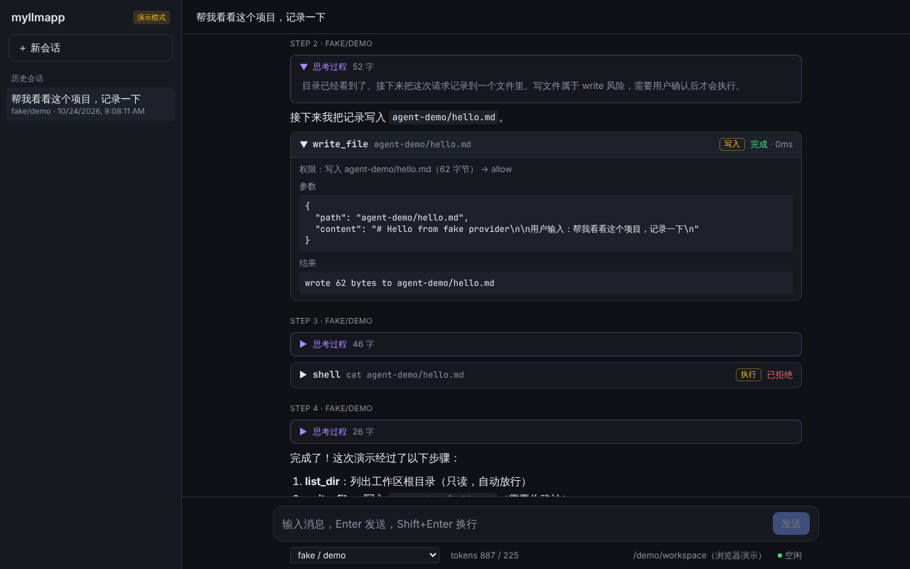
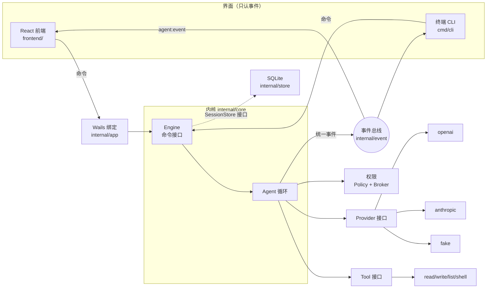

# myllmapp

一个**自己实现 agent harness** 的大模型桌面客户端（Go + Wails + React），也是一个学习项目：可读性和可理解性优先于功能数量。

- 🧠 **自研内核**：agent 循环、上下文、工具调用、权限确认全部自己写，不依赖任何 agent SDK
- 🔌 **多厂商**：OpenAI 兼容协议（OpenAI / DeepSeek / Qwen / Ollama …）+ Anthropic 原生协议（保留思考块与签名）+ 离线 fake；
  在界面上填 Base URL + API Key 即可接入，可从服务器获取模型列表、一键测试连接
- 👀 **可视化**：思考过程、工具调用、权限确认、图片、token 用量；为子 agent 树和后台任务预留了事件与界面
- 🖥 **内核与界面解耦**：同一个内核，既是 Wails 桌面应用，也是终端 CLI



## 架构概览



所有厂商的输出先变成少量中立的 **Delta**，内核再把它们翻译成带版本号的**统一事件**（`message_start`、`thinking_delta`、`tool_call`、`permission_request` …），界面只消费事件。详见 [docs/architecture.md](docs/architecture.md)。

## 快速开始

### 环境要求

- Go ≥ 1.26（更旧时会自动下载工具链）
- Node.js ≥ 20.19，npm
- 桌面端另需 [Wails CLI v2.17](https://wails.io) 与平台依赖（`wails doctor` 检查），见 [docs/usage.md](docs/usage.md)

### 不需要任何密钥，先跑起来

```bash
# 1. 测试
go test ./...

# 2. CLI 演示：思考 → 工具调用 → 权限确认 → 结果 → 回答
make demo

# 3. 交互式 CLI（默认 fake 厂商）
go run ./cmd/cli

# 4. 前端（浏览器演示模式）
cd frontend && npm install && npm run dev
```

### 接入真实模型

最简单：打开桌面端，点左下角 **⚙ 设置 · 模型厂商**，填 Base URL 和 API Key，获取模型列表，测试连接，保存。详见 [docs/usage.md](docs/usage.md#2-配置厂商)。

也可以用配置文件 / 环境变量（CLI 同样适用）：

```bash
cp config.example.toml config.toml   # 已在 .gitignore 中
export ANTHROPIC_API_KEY=...          # 或 DEEPSEEK_API_KEY / OPENAI_API_KEY ...
go run ./cmd/cli -provider anthropic
```

### 桌面端

```bash
wails dev      # 开发模式（Ubuntu 24.04+ 加 -tags webkit2_41）
wails build    # 打包到 build/bin/

./scripts/build.sh            # 或者用一键打包脚本：自动识别系统并检查依赖
./scripts/build.sh --windows  # 在 macOS / Linux 上交叉编译 Windows 版
```

## 目录结构

```
.
├── main.go                     Wails 桌面端入口（带构建标签，普通 go build 会跳过）
├── wails.json                  Wails 项目配置
├── config.example.toml         配置示例（复制为 config.toml 使用）
├── Makefile                    常用命令
├── scripts/build.sh            一键打包：按当前系统编译桌面应用，可交叉编译 Windows 版
├── assets_*.go                 前端资源嵌入（只在 production 构建中嵌入）
├── build/                      Wails 平台资源（图标、Windows manifest）；build/bin/ 是产物，不提交
├── cmd/cli/                    终端入口：同一个内核，彩色渲染或 JSONL 输出事件
├── internal/
│   ├── event/                  统一事件协议（带版本号）与进程内事件总线 —— 整个项目的核心契约
│   ├── provider/               厂商中立的消息模型、Provider 接口、适配器注册表
│   │   ├── sse/                极简 SSE 解析器
│   │   ├── openai/             OpenAI 兼容协议适配器
│   │   ├── anthropic/          Anthropic 原生协议适配器（思考块与签名）
│   │   ├── fake/               剧本驱动的假厂商，用于测试与离线演示
│   │   └── all/                空导入注册所有适配器
│   ├── tool/                   Tool 接口与注册表
│   │   └── builtin/            内置工具：read_file / write_file / list_dir / shell
│   ├── permission/             风险等级、权限策略、等待用户确认的会合点
│   ├── core/                   内核：agent 循环、Delta 累加、工具执行、会话、重放、Engine 命令接口
│   ├── store/                  会话持久化（SQLite 纯 Go 驱动 / 内存）
│   ├── config/                 读取 TOML 配置与环境变量密钥
│   ├── settings/               界面上配置的厂商：持久化到 settings.json、与配置文件合并、修改后热更新
│   ├── bootstrap/              组合根：把各层组装成 Engine（CLI 与桌面端共用）
│   ├── app/                    Wails 绑定层：命令转发 + 事件转发，不含业务逻辑
│   ├── mcp/                    预留：MCP 工具适配（ToolAdapter 已实现，Client 未实现）
│   ├── plugin/                 预留：技能 / 斜杠命令 / 钩子 / 状态栏脚本接口
│   └── archtest/               仓库级守卫测试：doc.go、密钥扫描、示例配置
├── frontend/
│   └── src/
│       ├── protocol/           事件协议的 TypeScript 镜像
│       ├── bridge/             后端命令接口：Wails 实现 + 浏览器演示实现（回放录制事件）
│       ├── store/              reducer（事件 → 状态的纯函数）+ Zustand store
│       └── components/         消息流、思考卡片、工具卡片、权限弹窗、状态栏、会话栏
└── docs/                       设计与使用文档
```

## 推荐阅读顺序

按这个顺序读，每一步都建立在上一步之上。括号里是读完应该能回答的问题。

1. **[docs/event-protocol.md](docs/event-protocol.md) → [internal/event/payloads.go](internal/event/payloads.go)、[event.go](internal/event/event.go)、[bus.go](internal/event/bus.go)**
   （界面能看到哪些事件？一轮对话产生的事件序列长什么样？为什么事件总线用同步回调？）
2. **[internal/provider/message.go](internal/provider/message.go)、[provider.go](internal/provider/provider.go)**
   （会话历史存的是什么结构？厂商需要实现什么？Delta 有哪几种，为什么厂商不直接返回完整消息？）
3. **[internal/tool/tool.go](internal/tool/tool.go)、[internal/permission/permission.go](internal/permission/permission.go)**
   （工具怎么声明风险？"先登记后通知"解决了什么竞态？）
4. **[internal/core/agent.go](internal/core/agent.go) 的 `Run` → [accumulator.go](internal/core/accumulator.go) → [tools.go](internal/core/tools.go)**  ⭐ 核心
   （循环何时结束？Delta 如何同时变成历史和事件？取消、出错时历史如何保持合法？）
5. **[internal/core/engine.go](internal/core/engine.go)、[session.go](internal/core/session.go)、[replay.go](internal/core/replay.go)**
   （界面能对内核发哪些命令？会话如何保存、恢复？）
6. **[internal/core/engine_test.go](internal/core/engine_test.go)** 的 `TestDemoFullLoop`
   （用 fake provider 把整个循环跑一遍，事件顺序逐一断言——最好的"可执行文档"）
7. **一个厂商适配器：[internal/provider/anthropic/anthropic.go](internal/provider/anthropic/anthropic.go)**（或 openai）及其测试
   （SSE 事件如何翻译成 Delta？思考签名怎么保存？）
8. **[internal/bootstrap/bootstrap.go](internal/bootstrap/bootstrap.go) → [cmd/cli/main.go](cmd/cli/main.go)**
   （具体实现在哪里被组装？一个最小的"界面"需要做哪几件事？）
9. **[internal/app/app.go](internal/app/app.go) → [frontend/src/bridge/wails.ts](frontend/src/bridge/wails.ts)**
   （Go 方法和事件如何到达前端？）
10. **[frontend/src/store/reducer.ts](frontend/src/store/reducer.ts) → [chatStore.ts](frontend/src/store/chatStore.ts) → [components/](frontend/src/components/)**
    （事件如何变成界面状态？工具卡片的状态机？为什么切换会话要先重置状态再调用后端？）

之后按兴趣读 [docs/design/](docs/design/) 中的模块设计和 [docs/roadmap.md](docs/roadmap.md)。

## 一次请求经过哪些文件和函数

以桌面端发送"帮我写个文件"为例（模型调用 `write_file`，需要确认）：

| # | 位置 | 发生了什么 |
| --- | --- | --- |
| 1 | `frontend/src/components/Composer.tsx` `submit` | 用户回车，调用 store 动作 |
| 2 | `frontend/src/store/chatStore.ts` `send` | → `backend().send(text)` |
| 3 | `frontend/src/bridge/wails.ts` | → `window.go.app.App.Send(text)` |
| 4 | `internal/app/app.go` `App.Send` | 起 goroutine 调用 `Engine.Send`，立即返回 |
| 5 | `internal/core/engine.go` `Engine.Send` | 占用运行权，取出 Provider，新建 `Agent` |
| 6 | `internal/core/agent.go` `Agent.Run` | 发 `turn_start` / `user_message`，进入循环 |
| 7 | `internal/core/agent.go` `callModel` | 发 `message_start`，调用 `Provider.Stream` |
| 8 | `internal/provider/anthropic/anthropic.go` `Stream` | HTTP 请求 → `sse.Reader` → 翻译成 `Delta` 回调 |
| 9 | `internal/core/accumulator.go` `add` + `agent.go` `translateDelta` | Delta 累加成消息；同时翻译成 `thinking_delta` / `text_delta` / `tool_call` |
| 10 | `internal/event/bus.go` `Bus.Publish` | 补全信封，同步通知订阅者 |
| 11 | `internal/app/app.go` `Startup` 中的订阅 | `runtime.EventsEmit("agent:event", ev)` |
| 12 | `frontend/src/bridge/wails.ts` `onEvent` → `chatStore.ts` | `set(s => applyEvent(s, ev))` |
| 13 | `frontend/src/store/reducer.ts` `applyEvent` | 更新时间线、工具字典 → React 重渲染 `ThinkingCard` / `Markdown` / `ToolCallCard` |
| 14 | `internal/core/tools.go` `runTools` → `runTool` | 查找工具 → `Policy.Evaluate` 返回 Ask |
| 15 | `internal/core/tools.go` `askPermission` → `internal/permission/permission.go` `Broker.Request` | 登记 → 发 `permission_request` → 阻塞等待 |
| 16 | `frontend/src/components/PermissionDialog.tsx` | 用户点"允许" → `respondPermission` → `App.RespondPermission` → `Engine.RespondPermission` → `Broker.Resolve` |
| 17 | `internal/core/tools.go` | 发 `permission_resolved`，`Tool.Execute`（`internal/tool/builtin/write_file.go`），发 `tool_result` |
| 18 | `internal/core/agent.go` `Run` | 工具结果追加为 user 消息，回到第 7 步；模型这次只回文本 → 发 `turn_end` |
| 19 | `internal/core/engine.go` `Send` | `Store.SaveSession`（`internal/store/sqlite.go`） |
| 20 | `frontend/src/store/chatStore.ts` | 收到 `turn_end` → 解锁输入框，刷新会话列表和状态栏 token |

时序图见 [docs/architecture.md §4](docs/architecture.md#4-一次完整请求的时序)。

## 文档索引

| 文档 | 内容 |
| --- | --- |
| [docs/tech-design.md](docs/tech-design.md) | 开工前的技术方案：选型理由、分层、关键取舍 |
| [docs/architecture.md](docs/architecture.md) | 分层图、核心接口、完整请求时序图、设计决策表 |
| [docs/event-protocol.md](docs/event-protocol.md) | 统一事件协议规范：信封、每个事件的字段与示例 JSON、版本规则 |
| [docs/design/agent-loop.md](docs/design/agent-loop.md) | 内核循环：流程图、不变式、取消、最大步数 |
| [docs/design/providers.md](docs/design/providers.md) | 厂商适配：中立模型、Delta、OpenAI/Anthropic 映射、降级矩阵 |
| [docs/design/tools-and-permissions.md](docs/design/tools-and-permissions.md) | 工具接口、内置工具、权限策略与 Broker |
| [docs/design/persistence.md](docs/design/persistence.md) | SQLite 表结构、迁移、写入策略 |
| [docs/design/frontend-state.md](docs/design/frontend-state.md) | 前端分层、reducer、工具状态机、演示模式 |
| [docs/design/settings.md](docs/design/settings.md) | 界面配置厂商：两层配置的合并规则、热更新、密钥存储 |
| [docs/extending.md](docs/extending.md) | 如何新增厂商 / 工具 / 子 agent / 界面 |
| [docs/roadmap.md](docs/roadmap.md) | 后续阶段规划与每个预留能力的接口状态 |
| [docs/usage.md](docs/usage.md) | 安装依赖、配置厂商、CLI 调试、开发模式、打包、常见问题 |

## License

[MIT](LICENSE)
