<div align="center">


# Mosaic

**一个桌面端的 AI 编码工作台——连接你自己的大模型，让它在你选定的工作区里读代码、改文件、跑命令。**<br>
每一步都看得见，危险操作先问你。

[](LICENSE)
[](go.mod)
[](https://wails.io)
[](frontend/package.json)
[](https://github.com/crazyjums/mosaic/releases)

[下载](https://github.com/crazyjums/mosaic/releases) ·
[快速开始](#快速开始) ·
[使用手册](docs/usage.md) ·
[架构](docs/architecture.md) ·
[路线图](docs/roadmap.md) ·
[更新日志](CHANGELOG.md) ·
[反馈问题](https://github.com/crazyjums/mosaic/issues)

</div>

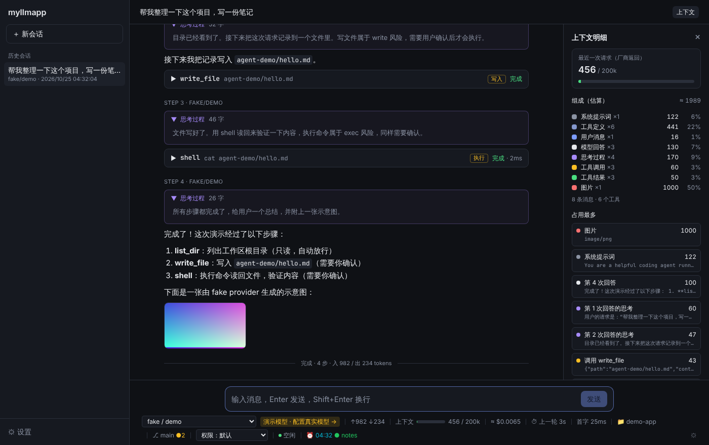

## 为什么做 Mosaic

市面上的 AI 编码工具大多把 agent 当成黑盒。Mosaic 反过来：**agent 循环、上下文、工具调用、权限确认全部自己实现**（不依赖任何 agent SDK），
并且把每一步都摊开给你看；它同时也是一个学习项目——可读性和可理解性优先于功能数量。

名字来自马赛克：许多小块（厂商、工具、技能、MCP、皮肤）拼成一个整体，每一块都可以替换。

## 功能

**对话与 agent**

- 🧠 **自研内核**：流式输出、多步工具调用、取消、最大步数保险丝；内核与界面解耦，同一个内核既是 Wails 桌面应用，也是终端 CLI
- 🧵 **多会话同时运行**：切换或新建会话不会打断正在运行的会话，后台继续跑；会话列表标出“运行中 / 待确认 / 有新结果”
- 📨 **发送队列**：agent 工作时输入框不会锁住——新消息按会话排队、按顺序自动发出，可以查看、删除、置前；停止只取消当前会话的这一轮，队列保留
- 📎 **图片与文本附件**：粘贴、拖拽或选择图片、Markdown / 纯文本文件，随消息一起发给模型（其他类型后续支持）
- 🗜 **上下文压缩**：估算占用超过窗口的 80% 时，把较早的对话摘要成一条消息，最近几轮原样保留；绝不拆开工具调用和它的结果（需要在厂商配置里填模型的上下文窗口）
- 🧩 **插件、技能（Skills）与 MCP**：可安装插件（技能 / 命令 / MCP 工具，插件市场或 Git 地址安装，安装前确认）；用 Markdown 写可复用的做法，输入 `/` 调用；界面里添加 stdio / HTTP 的 MCP 服务器，工具自动接入、照常走权限确认

**模型与账号**

- 🔌 **多厂商**：OpenAI 兼容协议（OpenAI / DeepSeek / Qwen / Ollama …）+ Anthropic 原生协议（保留思考块与签名）；填 Base URL + API Key 即可，可获取模型列表、一键测试连接
- 🔑 **用 ChatGPT 账号登录**：官方的 Sign in with ChatGPT，直接用 ChatGPT 套餐（Go / Plus / Pro）的额度调用 GPT 模型，不需要 API Key
- 🔀 **模型组故障转移**、🌐 **按厂商的网络代理**、📊 **用量统计**（按天展开的 token 与花费预估，含缓存口径，可导出 CSV）

**看得见、管得住**

- 📦 **产物面板**：agent 写出的网页（沙箱预览）、SVG、Mermaid / Graphviz 流程图、Markdown 都能直接预览，文件路径点击用默认浏览器 / 程序打开，悬停显示绝对路径
- 👀 **可视化**：思考过程（折叠时也能看到真实的“思考摘要”）、工具调用、权限确认、模型生成的 SVG / PNG / Mermaid 图、上下文明细面板
- 🛡 **权限可控**：四档权限模式 + 按命令 / 路径匹配的规则（如 `go test*` 放行、`rm *` 拒绝）+ 工具开关；每个会话只能读写自己的工作区
- 🌿 **Git 窗口**：点击状态栏的分支，打开只读的 Git 窗口——分支图、提交历史、提交详情与着色 diff、工作区变更
- 🖥 **可自定义的状态栏**：上下文占用、预估花费、首字延迟、ChatGPT 额度、git 分支、自定义脚本……

**体验**

- 🎨 **皮肤**：7 套内置配色（深浅两用），可新建 / 编辑 / 导入 / 导出自定义皮肤
- ⚙️ **设置都在界面上**：修改即时生效；API Key 存系统钥匙串；中英文界面
- ⬆️ **自动更新**：应用内检查、下载、校验签名、替换并重启（见 [docs/design/auto-update.md](docs/design/auto-update.md)）

## 界面一览

> 截图来自桌面端 / 浏览器演示模式，对话使用内置的 fake 演示厂商；ChatGPT 账号为演示数据。

| | |
| --- | --- |
| 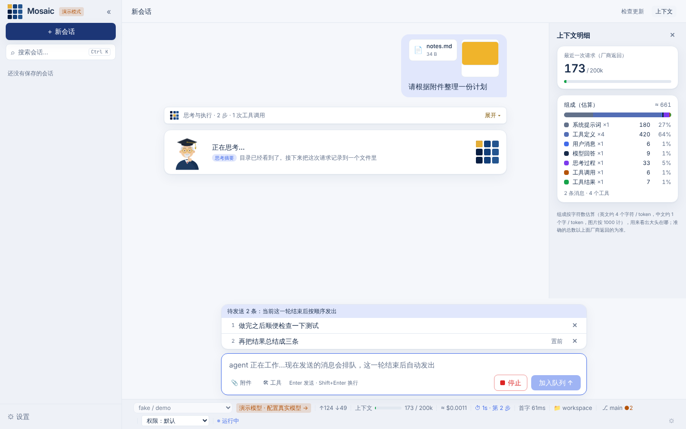 | 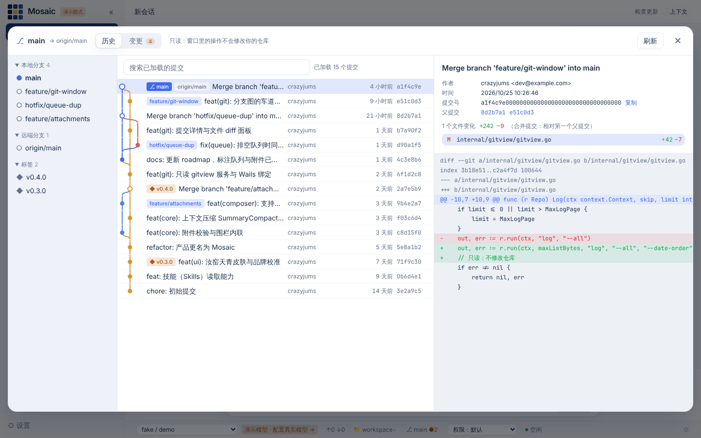 |
| **发送队列与附件**：agent 工作时继续输入，消息排队等候；附件以卡片和缩略图随消息显示；折叠的过程里露出真实的“思考摘要” | **Git 窗口**：分支图、提交历史、提交详情与 diff、工作区变更；全程只读 |
| 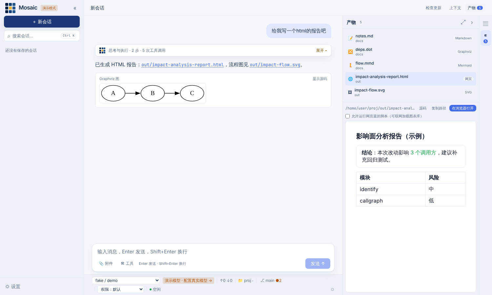 | |
| **产物面板**：右侧标签页（上下文 / 产物，可折叠），点文件预览网页、流程图、文档 | |
| 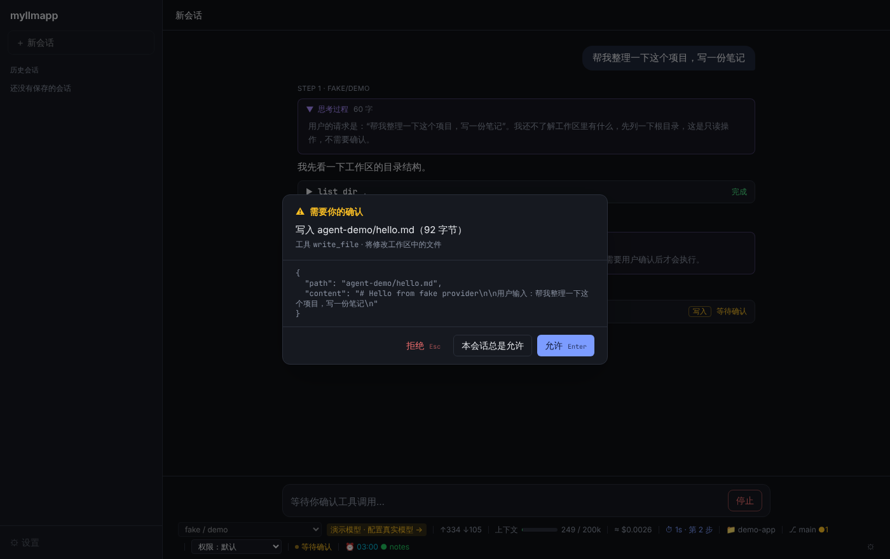 | 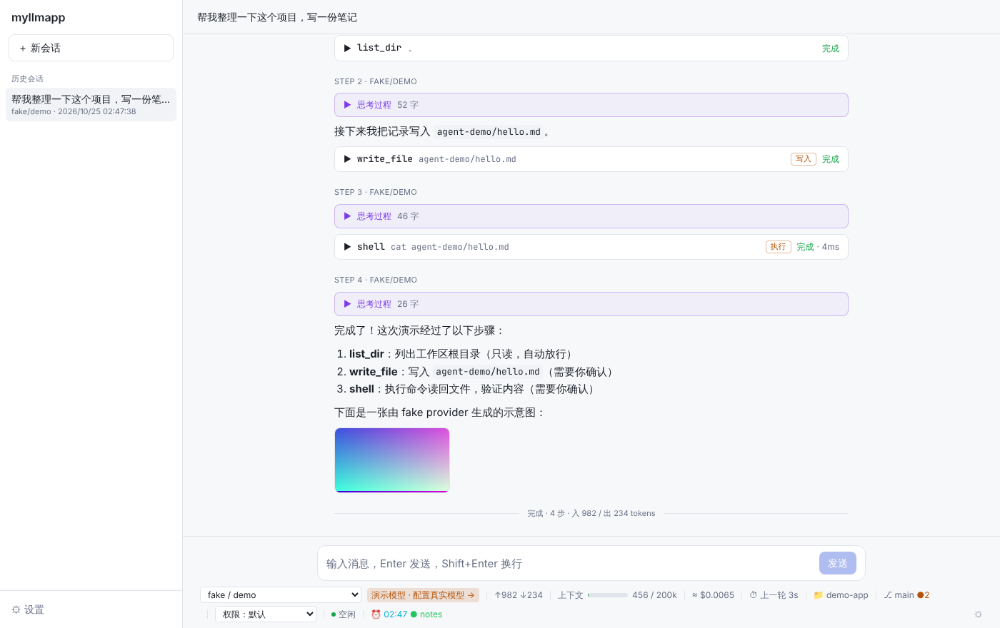 |
| **权限确认**：写文件、执行命令前停下来等你确认；本会话总是允许、拒绝后模型会换个办法继续 | **浅色主题**：思考过程默认在输出结束后折叠 |
| 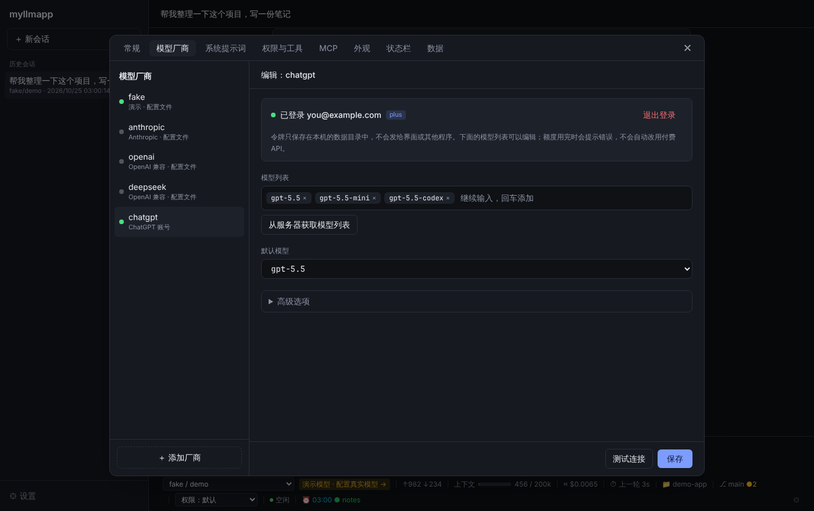 | 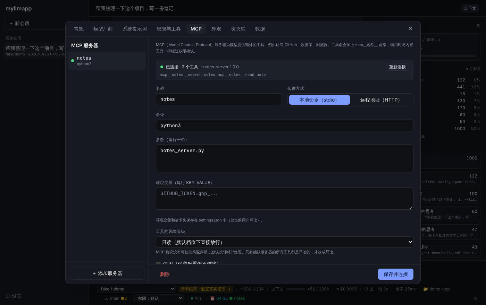 |
| **用 ChatGPT 账号登录**：登录后自动出现 chatgpt 厂商，显示本应用用掉的套餐额度 | **MCP**：显示连接状态和服务器提供的工具，进程退出时自动移除工具 |
| 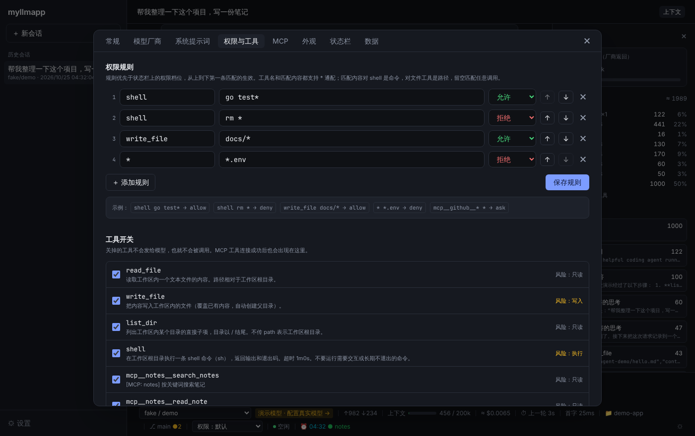 | 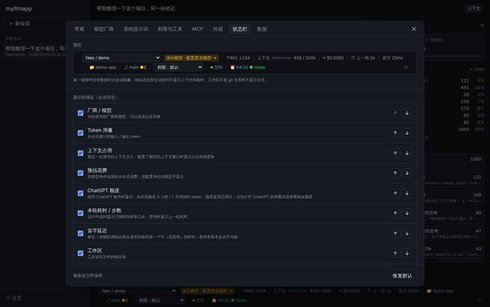 |
| **权限规则与工具开关**：规则优先于权限档位，MCP 工具也在这里 | **状态栏**：选择显示的项和顺序，支持自定义脚本（ANSI 颜色） |
| 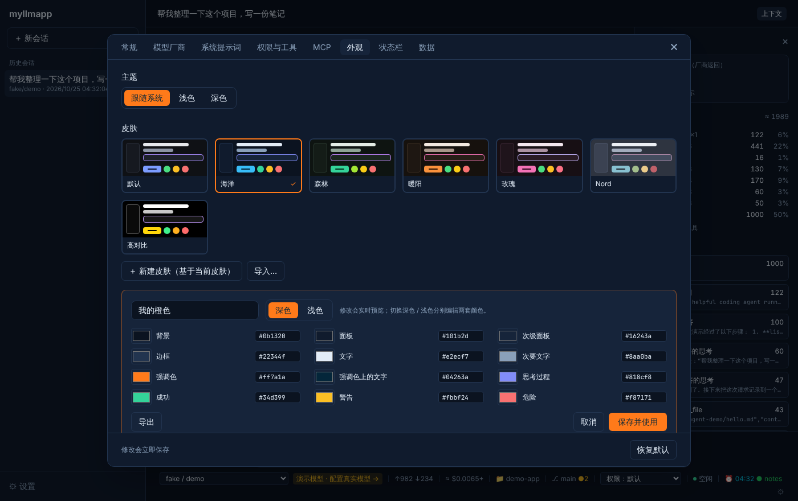 | 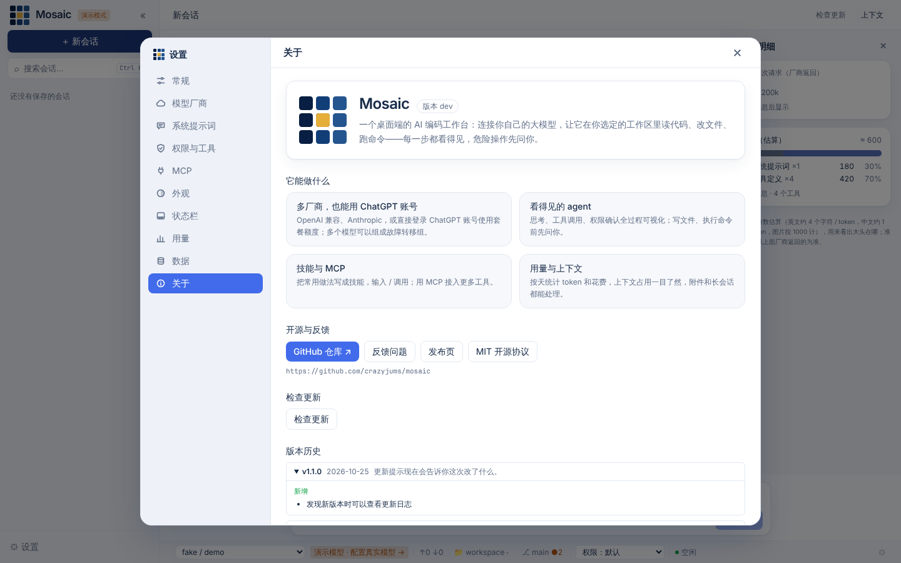 |
| **皮肤**：内置配色 + 自定义皮肤编辑器（实时预览，导入 / 导出 JSON） | **关于**：项目介绍、版本与更新、开源地址 |

## 快速开始

### 下载使用

到 [Releases](https://github.com/crazyjums/mosaic/releases) 下载对应系统的安装包（Windows / macOS / Linux），打开后：

1. 点左下角 **⚙ 设置 → 模型厂商**，选一个预设或自定义，填 Base URL 和 API Key，获取模型列表，测试连接，保存；或者选 **用 ChatGPT 账号登录**；
2. 在状态栏选择一个**工作区**（你的代码仓库），开始对话。

没有密钥也可以先体验：用 `go run ./cmd/cli -demo`（见下）或前端的浏览器演示模式，都使用内置的离线演示厂商（fake）。

### 从源码运行

环境要求：Go ≥ 1.26、Node.js ≥ 20.19、[Wails CLI v2.17](https://wails.io)（桌面端，`wails doctor` 检查依赖）。

```bash
git clone https://github.com/crazyjums/mosaic.git
cd mosaic

go test ./...                          # 测试（不需要任何密钥）
make demo                              # CLI 演示：思考 → 工具调用 → 权限确认 → 结果 → 回答
go run ./cmd/cli -demo                 # 交互式 CLI，使用离线演示厂商
(cd frontend && npm install && npm run dev)   # 前端的浏览器演示模式

wails dev      # 桌面端开发模式（Ubuntu 24.04+ 加 -tags webkit2_41）
wails build    # 打包到 build/bin/
./scripts/build.sh            # 一键打包：自动识别系统并检查依赖
./scripts/build.sh --windows  # 在 macOS / Linux 上交叉编译 Windows 版
```

> 仓库已更名为 Mosaic，但 Go module 路径（`github.com/crazyjums/myllmapp`）、数据目录（`~/.myllmapp`）暂时沿用旧名（可执行文件和安装包已改名为 `mosaic`），以免一次改动牵连太多；之后会单独迁移。

### 接入真实模型

三种方式任选（详见 [docs/usage.md](docs/usage.md#2-配置厂商)）：

1. **界面配置**：⚙ 设置 → 模型厂商；
2. **用 ChatGPT 账号登录**：⚙ 设置 → 模型厂商 → 用 ChatGPT 账号登录（CLI 里是 `/login`）；
3. **配置文件 / 环境变量**（CLI 同样适用）：

```bash
cp config.example.toml config.toml   # 已在 .gitignore 中
export ANTHROPIC_API_KEY=...          # 或 DEEPSEEK_API_KEY / OPENAI_API_KEY ...
go run ./cmd/cli -provider anthropic
```

CLI 里输入 `/help` 查看命令：`/model` 切换模型、`/mode` 切换权限模式、`/login` / `/logout` 登录 ChatGPT 账号等。

## 使用说明里的几个要点

- **会话之间并发，会话内排队**：多个会话可以同时运行；同一个会话里 agent 运行时发的消息会排队，这一轮结束后按顺序发出（详见 [路线图](docs/roadmap.md#并发与排队)）。多个会话同时改同一个工作区没有互斥，请自己留意冲突。
- **压缩上下文需要知道窗口大小**：在 ⚙ 设置 → 模型厂商 → 高级选项 里给模型填上“上下文窗口”，达到 80% 时才会自动压缩；没填则不压缩。压缩会改写会话历史（较早的原文不再保留，只留摘要）。
- **Git 窗口是只读的**：不会 commit / checkout / push，也不会执行仓库配置里指定的外部程序。
- **安全默认值**：模型只能读写所选的工作区；写文件、执行命令默认需要确认；密钥只存在系统钥匙串或你的配置里，不会发给前端，也绝不要提交进仓库。

## 架构概览

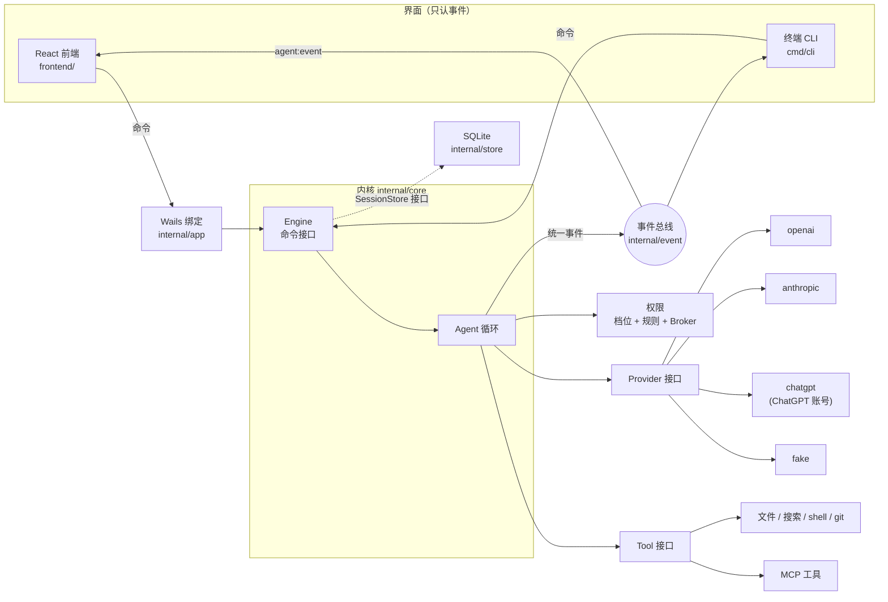

所有厂商的输出先变成少量中立的 **Delta**，内核再把它们翻译成带版本号的**统一事件**（`message_start`、`thinking_delta`、`tool_call`、`permission_request` …），界面只消费事件。详见 [docs/architecture.md](docs/architecture.md)。

## 路线图

已完成：多厂商与 ChatGPT 账号、权限与规则、MCP、技能、用量与故障转移、自动更新、皮肤、发送队列、多会话同时运行、图片 / 文本附件、上下文压缩、Git 窗口。

已完成（续）：插件系统（技能 / 斜杠命令 / MCP 工具，设置 → 插件）。

计划中：子 agent 与后台任务、更多附件类型（PDF 等）、飞书插件与钩子。完整清单与每个预留能力的接口状态见 [docs/roadmap.md](docs/roadmap.md)。

## 参与贡献

欢迎提 Issue 和 PR。提交前请运行：

```bash
go vet ./... && go test ./...
(cd frontend && npx tsc --noEmit && npx vitest run && npx vite build)
```

约定：每个 Go 包要有 `doc.go` 说明“负责什么 / 不负责什么”（`internal/archtest` 会检查）；注释写“为什么”而不是“做什么”；新增界面文字要补英文翻译（`i18n.test.ts` 会检查）；提交按模块拆分。
想新增厂商 / 工具 / 界面，先读 [docs/extending.md](docs/extending.md)。

## 开发者导览

<details>
<summary><b>目录结构</b></summary>


```
.
├── main.go                     Wails 桌面端入口（带构建标签，普通 go build 会跳过）
├── wails.json                  Wails 项目配置
├── config.example.toml         配置示例（复制为 config.toml 使用）
├── Makefile                    常用命令
├── scripts/build.sh            一键打包：按当前系统编译桌面应用，可交叉编译 Windows 版
├── assets_*.go                 前端资源嵌入（只在 production 构建中嵌入）
├── build/                      Wails 平台资源（图标、Windows manifest）；build/bin/ 是产物，不提交
├── catalog/                    随应用发布的插件目录：registry.json（插件列表）和 bundled/（内置示例插件，也是插件作者的参考）
├── cmd/cli/                    终端入口：同一个内核，彩色渲染或 JSONL 输出事件
├── internal/
│   ├── event/                  统一事件协议（带版本号）与进程内事件总线 —— 整个项目的核心契约
│   ├── provider/               厂商中立的消息模型、Provider 接口、适配器注册表
│   │   ├── sse/                极简 SSE 解析器
│   │   ├── openai/             OpenAI 兼容协议适配器
│   │   ├── anthropic/          Anthropic 原生协议适配器（思考块与签名）
│   │   ├── chatgpt/            Responses API 适配器（ChatGPT 账号登录，使用套餐额度）
│   │   ├── fake/               剧本驱动的假厂商，用于测试与离线演示
│   │   └── all/                空导入注册所有适配器
│   ├── tool/                   Tool 接口与注册表
│   │   └── builtin/            内置工具：读写编辑、搜索、文件管理、shell、git、todo
│   ├── permission/             风险等级、权限策略、等待用户确认的会合点
│   ├── core/                   内核：agent 循环、Delta 累加、工具执行、会话、重放、Engine 命令接口
│   ├── store/                  会话持久化（SQLite 纯 Go 驱动 / 内存）
│   ├── config/                 读取 TOML 配置与环境变量密钥
│   ├── settings/               界面上的所有设置：持久化到 settings.json（可选钥匙串）、与配置文件合并、修改后热更新
│   ├── secret/                 系统钥匙串（macOS 钥匙串 / Windows 凭据管理器 / Linux Secret Service）
│   ├── siwc/                   用 ChatGPT 账号登录：动态注册、PKCE、本地回调、令牌刷新与吊销
│   ├── workspace/              工作区信息（git 分支、未提交改动），供状态栏显示
│   ├── gitview/                Git 窗口的只读数据：提交图谱、分支、变更、diff
│   ├── sysproc/                启动子进程的平台差异（Windows 上不弹出控制台窗口）
│   ├── bootstrap/              组合根：把各层组装成 Engine（CLI 与桌面端共用）
│   ├── app/                    Wails 绑定层：命令转发 + 事件转发，不含业务逻辑
│   ├── mcp/                    MCP 客户端（stdio / Streamable HTTP）与连接管理器
│   ├── skill/                  技能（Skills）：发现、解析、注入提示词
│   ├── update/                 自动更新：检查、下载、验签、替换
│   ├── plugin/                 插件宿主（技能 / 斜杠命令 / MCP 工具）与状态栏脚本；钩子为预留
│   └── archtest/               仓库级守卫测试：doc.go、密钥扫描、示例配置
├── frontend/
│   └── src/
│       ├── protocol/           事件协议的 TypeScript 镜像
│       ├── bridge/             后端命令接口：Wails 实现 + 浏览器演示实现（回放录制事件）
│       ├── store/              reducer（事件 → 状态的纯函数）+ Zustand store
│       ├── components/         消息流、思考卡片、工具卡片、权限弹窗、状态栏、会话栏、设置页
│       └── i18n.ts             中英文界面（以中文原文为 key 的查表）
└── docs/                       设计与使用文档；docs/images/ 是 README 的截图
```

</details>

<details>
<summary><b>推荐阅读顺序</b>（从零读懂内核）</summary>


按这个顺序读，每一步都建立在上一步之上。括号里是读完应该能回答的问题。

1. **[docs/event-protocol.md](docs/event-protocol.md) → [internal/event/payloads.go](internal/event/payloads.go)、[event.go](internal/event/event.go)、[bus.go](internal/event/bus.go)**
   （界面能看到哪些事件？一轮对话产生的事件序列长什么样？为什么事件总线用同步回调？）
2. **[internal/provider/message.go](internal/provider/message.go)、[provider.go](internal/provider/provider.go)**
   （会话历史存的是什么结构？厂商需要实现什么？Delta 有哪几种，为什么厂商不直接返回完整消息？）
3. **[internal/tool/tool.go](internal/tool/tool.go)、[internal/permission/permission.go](internal/permission/permission.go)**
   （工具怎么声明风险？"先登记后通知"解决了什么竞态？）
4. **[internal/core/agent.go](internal/core/agent.go) 的 `Run` → [accumulator.go](internal/core/accumulator.go) → [tools.go](internal/core/tools.go)**  ⭐ 核心
   （循环何时结束？Delta 如何同时变成历史和事件？取消、出错时历史如何保持合法？）
5. **[internal/core/engine.go](internal/core/engine.go)、[session.go](internal/core/session.go)、[replay.go](internal/core/replay.go)**
   （界面能对内核发哪些命令？会话如何保存、恢复？）
6. **[internal/core/engine_test.go](internal/core/engine_test.go)** 的 `TestDemoFullLoop`
   （用 fake provider 把整个循环跑一遍，事件顺序逐一断言——最好的"可执行文档"）
7. **一个厂商适配器：[internal/provider/anthropic/anthropic.go](internal/provider/anthropic/anthropic.go)**（或 openai）及其测试
   （SSE 事件如何翻译成 Delta？思考签名怎么保存？）
8. **[internal/bootstrap/bootstrap.go](internal/bootstrap/bootstrap.go) → [cmd/cli/main.go](cmd/cli/main.go)**
   （具体实现在哪里被组装？一个最小的"界面"需要做哪几件事？）
9. **[internal/app/app.go](internal/app/app.go) → [frontend/src/bridge/wails.ts](frontend/src/bridge/wails.ts)**
   （Go 方法和事件如何到达前端？）
10. **[frontend/src/store/reducer.ts](frontend/src/store/reducer.ts) → [chatStore.ts](frontend/src/store/chatStore.ts) → [components/](frontend/src/components/)**
    （事件如何变成界面状态？工具卡片的状态机？为什么切换会话要先重置状态再调用后端？）

之后按兴趣读 [docs/design/](docs/design/) 中的模块设计和 [docs/roadmap.md](docs/roadmap.md)。

</details>

<details>
<summary><b>一次请求经过哪些文件和函数</b></summary>


以桌面端发送"帮我写个文件"为例（模型调用 `write_file`，需要确认）：

| # | 位置 | 发生了什么 |
| --- | --- | --- |
| 1 | `frontend/src/components/Composer.tsx` `submit` | 用户回车，调用 store 动作 |
| 2 | `frontend/src/store/chatStore.ts` `send` | 空闲时 → `backend().send(text, attachments)`；运行中先进入发送队列（`store/queue.ts`），这一轮结束后按顺序发出 |
| 3 | `frontend/src/bridge/wails.ts` | → `window.go.app.App.Send(text)` |
| 4 | `internal/app/app.go` `App.SendMessage` | 起 goroutine 调用 `Engine.SendInput`，立即返回（失败以 `error` 事件到达） |
| 5 | `internal/core/engine.go` `Engine.SendInput` | 占用运行权，取出 Provider，新建 `Agent` |
| 6 | `internal/core/agent.go` `Agent.RunInput` | 校验附件，发 `turn_start` / `user_message`，进入循环 |
| 7 | `internal/core/agent.go` `callModel` | 发 `message_start`，调用 `Provider.Stream` |
| 8 | `internal/provider/anthropic/anthropic.go` `Stream` | HTTP 请求 → `sse.Reader` → 翻译成 `Delta` 回调 |
| 9 | `internal/core/accumulator.go` `add` + `agent.go` `translateDelta` | Delta 累加成消息；同时翻译成 `thinking_delta` / `text_delta` / `tool_call` |
| 10 | `internal/event/bus.go` `Bus.Publish` | 补全信封，同步通知订阅者 |
| 11 | `internal/app/app.go` `Startup` 中的订阅 | `runtime.EventsEmit("agent:event", ev)` |
| 12 | `frontend/src/bridge/wails.ts` `onEvent` → `chatStore.ts` | `set(s => applyEvent(s, ev))` |
| 13 | `frontend/src/store/reducer.ts` `applyEvent` | 更新时间线、工具字典 → React 重渲染 `ThinkingCard` / `Markdown` / `ToolCallCard` |
| 14 | `internal/core/tools.go` `runTools` → `runTool` | 查找工具 → `Policy.Evaluate` 返回 Ask |
| 15 | `internal/core/tools.go` `askPermission` → `internal/permission/permission.go` `Broker.Request` | 登记 → 发 `permission_request` → 阻塞等待 |
| 16 | `frontend/src/components/PermissionDialog.tsx` | 用户点"允许" → `respondPermission` → `App.RespondPermission` → `Engine.RespondPermission` → `Broker.Resolve` |
| 17 | `internal/core/tools.go` | 发 `permission_resolved`，`Tool.Execute`（`internal/tool/builtin/write_file.go`），发 `tool_result` |
| 18 | `internal/core/agent.go` `Run` | 工具结果追加为 user 消息，回到第 7 步；模型这次只回文本 → 发 `turn_end` |
| 19 | `internal/core/engine.go` `SendInput` | `Store.SaveSession`（`internal/store/sqlite.go`） |
| 20 | `frontend/src/store/chatStore.ts` | 收到 `turn_end` → 解锁输入框，刷新会话列表和状态栏 token |

时序图见 [docs/architecture.md §4](docs/architecture.md#4-一次完整请求的时序)。

</details>

## 文档索引

| 文档 | 内容 |
| --- | --- |
| [docs/tech-design.md](docs/tech-design.md) | 开工前的技术方案：选型理由、分层、关键取舍 |
| [docs/architecture.md](docs/architecture.md) | 分层图、核心接口、完整请求时序图、设计决策表 |
| [docs/event-protocol.md](docs/event-protocol.md) | 统一事件协议规范：信封、每个事件的字段与示例 JSON、版本规则 |
| [docs/design/agent-loop.md](docs/design/agent-loop.md) | 内核循环：流程图、不变式、取消、最大步数 |
| [docs/design/providers.md](docs/design/providers.md) | 厂商适配：中立模型、Delta、OpenAI/Anthropic 映射、降级矩阵 |
| [docs/design/tools-and-permissions.md](docs/design/tools-and-permissions.md) | 工具接口、内置工具、权限策略与 Broker |
| [docs/design/persistence.md](docs/design/persistence.md) | SQLite 表结构、迁移、写入策略 |
| [docs/design/frontend-state.md](docs/design/frontend-state.md) | 前端分层、reducer、工具状态机、演示模式 |
| [docs/design/settings.md](docs/design/settings.md) | 界面设置：两层配置的合并规则、热更新、密钥与钥匙串、规则 / MCP / 状态栏脚本的持久化 |
| [docs/plugin-development.md](docs/plugin-development.md) | 插件开发指南：5 分钟上手、清单字段、技能 / 命令 / MCP / 配置表单、分发到市场 |
| [docs/design/plugin-system.md](docs/design/plugin-system.md) | 插件系统：plugin.json 格式、安装确认、MCP 来源管理、密钥与安全边界 |
| [docs/extending.md](docs/extending.md) | 如何新增厂商 / 工具 / 子 agent / 界面 |
| [docs/design/mosaic-ui.md](docs/design/mosaic-ui.md) | Mosaic 品牌与界面设计：Logo、皮肤、状态动效 |
| [docs/roadmap.md](docs/roadmap.md) | 后续阶段规划与每个预留能力的接口状态 |
| [docs/usage.md](docs/usage.md) | 安装依赖、配置厂商、CLI 调试、开发模式、打包、常见问题 |

## License

[MIT](LICENSE) © 2026 crazyjums
