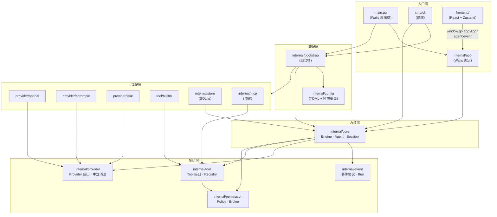
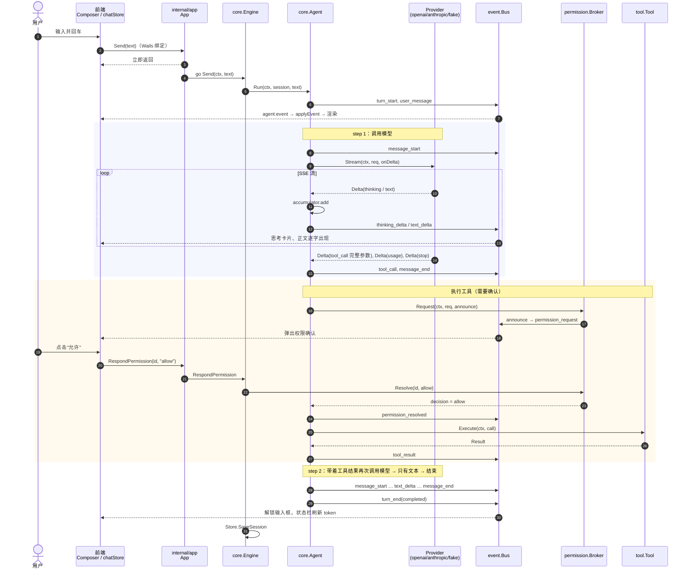

# 整体架构

## 1. 一句话

**内核（agent 循环）通过"命令 + 事件"对外，界面只是事件的消费者。** 桌面端和 CLI 是同一个内核的两种界面。

## 2. 分层图



依赖方向只能**从外向内**（图中从上往下）。几条硬性规则由测试自动检查：

| 规则 | 检查位置 |
| --- | --- |
| `internal/core` 不导入 Wails、具体厂商、store、任何第三方包 | `internal/core/arch_test.go` |
| 每个包都有 `doc.go` | `internal/archtest` |
| 仓库中没有疑似密钥 | `internal/archtest` |

### 各层职责

| 层 | 包 | 职责 |
| --- | --- | --- |
| 契约 | `event` | 统一事件协议与进程内事件总线 |
| | `provider` | 厂商中立的消息模型、`Provider` 接口、适配器注册表、配置档目录 |
| | `tool` | `Tool` 接口与注册表 |
| | `permission` | 风险等级、权限策略、"等待用户确认"的会合点 |
| 内核 | `core` | agent 循环、Delta 累加、工具执行、会话、重放、`Engine` 命令接口；预留压缩/子 agent/后台任务接口 |
| 适配 | `provider/openai`、`provider/anthropic`、`provider/fake` | 各协议 ↔ 中立 Delta |
| | `tool/builtin` | 四个内置工具 |
| | `store` | `core.SessionStore` 的 SQLite / 内存实现 |
| | `mcp`、`plugin` | 预留扩展点 |
| 装配 | `config`、`bootstrap` | 读配置；把具体实现组装成 `Engine` |
| 入口 | `cmd/cli`、`internal/app` + `main.go`、`frontend` | 两种界面 |

## 3. 两个关键接口

内核对外只有两个方向，CLI 和桌面端都只依赖它们：

```go
// 命令：core.Engine 的方法
Send(ctx, text)              // 发送消息，阻塞到本轮结束
Cancel()                     // 取消当前轮
RespondPermission(id, dec)   // 回复权限确认
NewSession() / LoadSession(id) / ListSessions() / DeleteSession(id)
SetModel(profile, model) / Status() / Profiles()

// 事件：core.Engine.Bus()
Subscribe(func(event.Event))
```

内核对内也只依赖接口：

```go
provider.Provider  // Stream(ctx, req, onDelta) error
tool.Tool          // Spec() / Summarize(input) / Execute(ctx, call)
permission.Policy  // Evaluate / Remember / Reset
core.SessionStore  // Save / Load / List / Delete
core.Compactor     // 预留：上下文压缩
```

## 4. 一次完整请求的时序

用户在桌面端输入"帮我写个文件"，模型先调用 `write_file`（需要确认），再给出回答。



## 5. 关键设计决策

| 决策 | 选择 | 考虑过的方案 / 不选的原因 |
| --- | --- | --- |
| 桌面框架 | Wails v2.17 | v3 仍是 beta，API 变动风险大；内核与 Wails 解耦，迁移只影响 `internal/app` 和 `main.go` |
| 界面与内核的接口 | 命令 + 单通道事件流 | 直接让前端轮询状态：实时性差；每种事件一个通道：Wails 不保证跨通道顺序 |
| 厂商输出 | 厂商只产生 Delta，内核统一组装消息 | 让厂商返回完整消息：每个厂商重复写组装逻辑，且历史和界面可能不一致 |
| 中立消息模型 | 内容块（Anthropic 风格） | OpenAI 风格（tool 角色）：表达不了思考签名、多块交错 |
| 事件总线 | 同步回调 | channel 扇出：要处理慢订阅者、丢事件、关闭，复杂度高 |
| 权限等待 | Broker：先登记后通知 + channel 会合 | 把等待逻辑写在 UI 层：内核无法脱离 UI 测试 |
| 持久化接口位置 | 在 core 定义，store 实现 | 在 store 定义：内核将依赖 SQLite |
| 会话恢复 | 历史消息重放成事件 | 专用"加载历史"接口：前端需要两套渲染逻辑 |
| 前端绑定 | 手写 `bridge/wails.ts` | 用 `wails generate` 生成：没有 Wails 环境时前端无法构建；生成的类型不如手写精确 |

各模块的详细设计见 [`docs/design/`](design/)。
