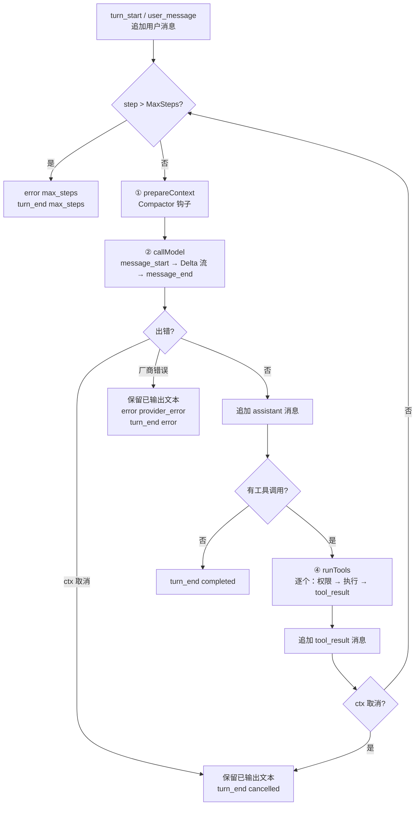

# 设计：内核循环（internal/core）

## 目标

把"调用模型 → 执行工具 → 回传结果 → 继续"这个循环写得**短、可读、每一步都可观察**，并且对以下情况都有确定的行为：取消、厂商出错、工具出错、模型编造工具、死循环。

代码入口：[`agent.go`](../../internal/core/agent.go) 的 `Agent.Run`。

## 概念

| 概念 | 代码 | 说明 |
| --- | --- | --- |
| 会话 Session | `session.go` | 一串中立消息 + 元数据 + 累计用量 |
| 轮 Turn | `Agent.Run` 一次调用 | 一次用户输入到 agent 停下 |
| 步 Step | 循环的一次迭代 | 一次模型调用（+ 随后的工具执行） |
| Engine | `engine.go` | 对外命令接口；持有当前会话、事件总线、Broker |

`Agent` 本身无状态，所有依赖通过 `AgentConfig` 注入。`Engine.Send` 每轮新建一个 `Agent`（只是一份配置，成本可以忽略），所以切换模型后不需要任何"刷新"逻辑。

## 主循环



所有出口都经过 `Run` 里的 `end()` 闭包，它保证**一定发出 `turn_end`**。前端依赖这一点解锁输入框。

## Delta 的双重去向

`callModel` 里每个 `provider.Delta` 同时做两件事：

```go
err := a.cfg.Provider.Stream(ctx, req, func(d provider.Delta) {
    acc.add(d)                  // 1. 累加成历史消息
    a.translateDelta(em, msgID, d) // 2. 翻译成事件推给界面
})
```

这样"存进历史的"和"界面看到的"永远来自同一份数据。累加规则见 [`accumulator.go`](../../internal/core/accumulator.go)：相邻同类片段合并；思考块收到签名后"封口"，后续思考片段开新块。

## 不变式

1. **每个 `tool_use` 都有配对的 `tool_result`。** `runTools` 无论成功、失败、拒绝、未知工具、取消，都为每个调用产出结果。否则下一次请求会被厂商拒绝（OpenAI 和 Anthropic 都要求配对）。测试：`TestCancelWhileWaitingForPermission` 的 `assertToolPairs`。
2. **中途失败时不留下不完整的块。** `salvagePartial` 只保留文本和图片：未完成的工具调用没有结果；未收到签名的思考块会被 Anthropic 拒绝。
3. **工具失败不是程序错误。** 工具用 `Result{IsError: true}` 表达失败，模型能看到并自我纠正；只有厂商错误、上下文错误会终止本轮。工具 panic 会被 `recover` 转成工具错误。

## 取消

- `Engine.Cancel()` 取消本轮的 `ctx`。
- 流式调用中：厂商适配器的 HTTP 请求带 ctx，会立即返回 `ctx.Err()`。
- 等待权限确认中：`Broker.Request` 的 `select` 收到 `ctx.Done()`，按拒绝处理，并发出 `permission_resolved{decision: deny, reason: cancelled}`。
- 执行 shell 中：`exec.CommandContext` 杀掉整个进程组。
- 剩余未执行的工具调用得到 "cancelled by user before execution" 结果。

## 最大步数

`MaxSteps`（默认 20）是"保险丝"。超出时发出 `error{code: max_steps, fatal: true}` 和 `turn_end{reason: max_steps}`。此时历史最后一条是工具结果，用户发送"继续"即可接着做。

## 预留扩展点

| 扩展点 | 文件 | 状态 |
| --- | --- | --- |
| 上下文压缩 `Compactor` | `compact.go` | `SummaryCompactor`（估算触发 + 摘要 + 保留最近几轮，不拆工具调用）；取消 → `cancelled`，失败 → 非致命 `compact_failed` 并继续，详见 roadmap |
| 子 agent | `subagent.go` | `SubagentDefinition` + `SubagentRegistry`（已实现）、`SubagentRunner`（接口） |
| 后台任务 | `task.go` | `TaskManager` 接口 |

子 agent 的实现不需要修改 `Agent`：用新的 `AgentConfig{ID: 新ID, ParentID: 调用者ID, Tools: 受限注册表}` 创建一个 Agent 即可，信封上的 `agent_id` / `parent_id` 已经由 `emitter` 自动填写。详见 [roadmap](../roadmap.md)。

## 考虑过的其他方案

- **把循环写成状态机（显式状态枚举 + 转移表）**：更"正规"，但对这个规模的循环，`for` + 几个 `if` 更容易读懂；状态机适合以后加入"暂停/恢复"之类更复杂的控制时再考虑。
- **并行执行工具**：见 [工具与权限](tools-and-permissions.md)。
- **Engine 持有长期存在的 Agent**：需要在切换模型时重建，且 Agent 会积累状态；每轮新建更简单。

## 测试

[`engine_test.go`](../../internal/core/engine_test.go) 用 fake provider + 真实内置工具 + 内存存储覆盖：完整演示流程（事件顺序逐一断言）、拒绝后继续、会话内允许、最大步数、等待确认时取消、厂商中途出错、无思考降级、未知工具、会话重放、切换模型、运行中拒绝并发命令。
