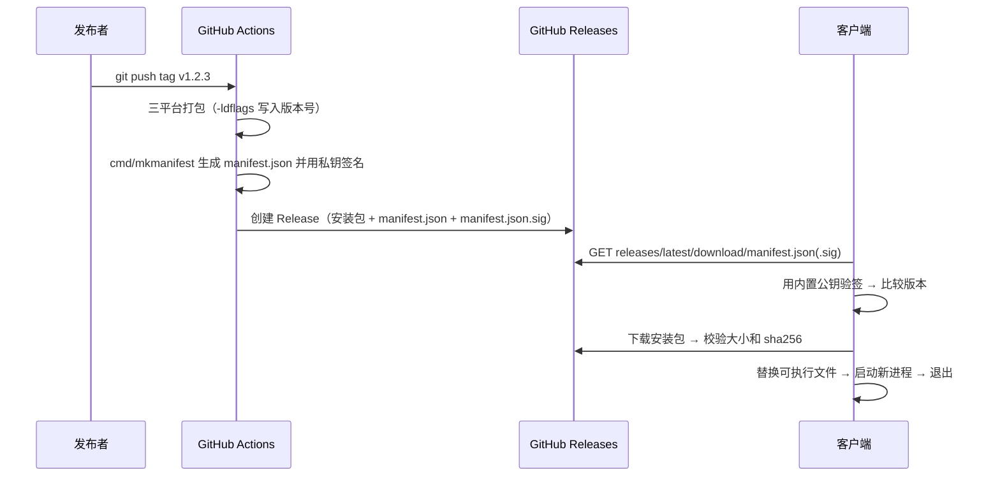

# 客户端自动更新

## 目标与取舍

- 用户在应用里看到"发现新版本"，点一下就能更新并自动重启。
- 不依赖 Wails V3（V3 仍是 beta；它的更新器也只替代"下载并替换"这一段，发布流水线和签名密钥管理仍要自己做），留在 Wails V2，更新逻辑自己实现，几乎全是 Go 标准库，将来迁移也不受影响。
- 更新机制本身是最大的攻击面（谁能篡改下载源，谁就能让所有客户端执行任意程序），所以**必须验签**。

## 整体流程



## 清单与签名

`manifest.json`：

```json
{
  "version": "1.2.3",
  "notes": "- 更新说明…",
  "pub_date": "2026-10-25T07:50:39Z",
  "page": "https://github.com/…/releases/tag/v1.2.3",
  "platforms": {
    "windows-amd64": {"url": "https://…/mosaic-windows-amd64.exe", "sha256": "…", "size": 16285184},
    "linux-amd64":   {"url": "https://…/mosaic-linux-amd64", "sha256": "…", "size": 15500144}
  }
}
```

`manifest.json.sig` 是对 `manifest.json` 全部字节的 ed25519 签名（base64）。客户端的检查顺序：下载清单和签名 → **先验签** → 再解析 JSON → 比较版本 → 校验平台条目。验签前的内容不进入任何解析逻辑。

两层校验各自防什么：签名保证清单是发布者发的（包括里面的下载地址和 sha256）；sha256 和大小保证下载到的安装包就是清单里说的那个。因此下载地址即使被劫持，也只能导致下载失败，不能让客户端装上别的程序。

其他约束：下载地址必须是 https（本机回环地址允许 http，仅供测试）；下载的字节数超过清单声明就中止；任何一步失败都不会动当前程序。

## 更新日志

用户在更新前需要知道两件事：**这次改了什么**，以及**值不值得更新**。所以清单里不只放一段文字，而是放结构化的日志，客户端据此分类展示并给出建议。

### 遵循的标准

| 标准 | 用在哪 |
| --- | --- |
| [Keep a Changelog](https://keepachangelog.com/zh-CN/1.1.0/) | `CHANGELOG.md` 的格式：每版一节 `## [1.2.3] - 2026-10-25`，按 新增 / 变更 / 弃用 / 移除 / 修复 / 安全 分组，最新的在前，顶部有 `[Unreleased]` |
| [语义化版本](https://semver.org/lang/zh-CN/) | 版本号规则（见下节），预发布版本带连字符 |
| [Conventional Commits](https://www.conventionalcommits.org/zh-hans/) | 没有手写日志时的兜底：按提交标题的前缀分类（`feat` 新增、`fix` 修复，`feat!` 不兼容变更；`docs` / `test` / `ci` / `chore` 不写入） |

在 Keep a Changelog 的六类之外多加了一类**不兼容变更**（对应 Conventional Commits 的 BREAKING CHANGE）：这类变更需要用户在更新前知道。

### 更新建议怎么得出

客户端把"当前版本之后的全部版本"合并起来判断（用户可能隔了好几个版本才更新），取最高等级：

| 等级 | 条件 | 界面 |
| --- | --- | --- |
| `critical` | 任何一个版本含**安全**修复 | 红色"安全更新，建议尽快更新" |
| `recommended` | 含**修复**、**移除**或**不兼容变更** | 橙色"建议更新" |
| `optional` | 只有新增和变更 | 灰色"可选更新" |

含不兼容变更时另外显示一条提示，要求更新前先阅读。等级由后端（`update.Advise`）算好，前端只负责显示；旧格式的清单（没有结构化日志）不显示等级，只显示纯文本说明。

### 日志从哪来

1. `CHANGELOG.md`：**手写，面向用户**，不要写内部实现细节。发布前把 `[Unreleased]` 的内容挪到新版本的小节下，再打 tag。程序会把 `CHANGELOG.md` 打包进自己，设置 → 关于里的"版本历史"只显示已经有小节的版本（`[Unreleased]` 不显示），而已发布的程序里改不了；所以发布流水线的 preflight 会在正式版的 tag 缺少对应小节时直接失败（预发布 tag 不检查），`internal/update` 里还有一条测试检查 CHANGELOG 格式。
2. CI 里 `mkmanifest sign -changelog CHANGELOG.md -commits-file commits.txt` 解析它，取最近 10 个版本写进清单的 `releases`，同时生成 GitHub Release 的正文。
3. 如果 `CHANGELOG.md` 里没有本版本的小节，自动退回用提交标题生成，并在 Actions 里输出警告 `CHANGELOG.md 里没有 x.y.z 的小节`。能发布，但自动生成的日志远不如人写的好读，建议补写。

清单里每个版本的结构：

```json
{"version": "1.3.0", "date": "2026-10-25", "summary": "一句话摘要",
 "sections": [{"kind": "security", "items": ["…"]}, {"kind": "added", "items": ["…"]}]}
```

`kind` 取值：`breaking` / `security` / `added` / `changed` / `fixed` / `deprecated` / `removed`。`notes` 字段仍然保留（最新一版的纯文本），给不认识 `releases` 的旧客户端显示，保证向后兼容。

### 界面

- 更新横幅：建议标签、"新增 3 · 修复 2"一行摘要、"查看更新日志"展开。
- 设置 → 关于：检查到新版本后显示同样的标签和完整日志。
- 跳过了几个版本时，把中间所有版本依次列出，最新的默认展开，其余折叠。

## 版本号

- 发布构建用 `-ldflags "-X github.com/crazyjums/myllmapp/internal/update.Version=1.2.3"` 写入；本地开发构建是 `dev`，**不检查更新**，免得开发时被提示更新并覆盖自己编译的程序。
- 比较规则（`update.Newer`）：按 主.次.修订 比较；同一个版本号下正式版比预发布版新；两个预发布版之间不比较。带连字符的 tag（`v1.2.3-beta.1`）发布时标成预发布，不会成为 `latest`，所以正式版用户收不到。

## 各平台怎么替换

| 平台 | 方式 |
| --- | --- |
| Windows | 运行中的 exe 不能覆盖，但可以改名：当前 exe → `.old`，新文件 → 原名；启动新进程后退出；新进程启动时清理 `.old`。第二步失败会把 `.old` 改回去（回滚）。 |
| Linux | 同样先改名再替换（Linux 也允许替换运行中的文件）。仅适用于直接运行的二进制；用 deb/rpm 安装的应走系统包管理器。 |
| macOS | **不自动安装**：`.app` 是目录，没有签名和公证时替换容易被 Gatekeeper 拦截。只提示新版本并打开发布页（`Info.Manual`）。 |

重启时新进程会带环境变量 `MYLLMAPP_UPDATED_FROM=<旧进程 pid>`，启动时先等旧进程退出（最多 10 秒）再初始化，避免两个实例同时打开同一个 SQLite 数据库。

程序目录不可写（例如装在 `C:\Program Files` 且没有管理员权限）时，下载这一步就会失败并提示手动安装；更新不会尝试提权。

## 代码位置

| 位置 | 作用 |
| --- | --- |
| `internal/update/` | 版本比较、清单验签、下载校验、替换、重启（不依赖 Wails，可直接 `go test`） |
| `internal/update/pubkey.txt` | 内置公钥（base64）。**为空时更新功能不可用**，界面上会说明原因 |
| `internal/app/update.go` | 绑定：`GetVersion`、`CheckUpdate`、`InstallUpdate`（后台下载）、`GetUpdateStatus`（前端轮询进度） |
| `cmd/mkmanifest/` | 发布侧工具：`genkey` 生成密钥，`sign` 生成并签名清单 |
| `.github/workflows/release.yml` | 打 tag 触发：三平台打包 → 签名清单 → 创建 Release |
| `frontend/src/store/updateStore.ts`、`UpdateBanner.tsx`、`AboutSettings.tsx` | 检查调度、横幅、设置 → 关于 |

前端只触发"检查"和"安装"；**安装时用的下载地址和 sha256 取自后端保存的最近一次检查结果**，不接受前端传来的任何地址。

## 一次性准备

1. 生成密钥：`go run ./cmd/mkmanifest genkey`。
2. 把**公钥**写进 `internal/update/pubkey.txt` 并提交。
3. 把**私钥**保存为 GitHub 仓库的加密变量 `UPDATE_SIGNING_KEY`（Settings → Secrets and variables → Actions）。**私钥绝不能提交进仓库，也不要发给任何人**；丢失或泄露时需要重新生成密钥，并发布一个用新公钥打包的版本——旧版本客户端只认旧公钥，所以泄露后旧用户只能手动重装一次。
4. 发布：`git tag v1.2.3 && git push origin v1.2.3`。流水线的第一步 `preflight` 会运行 `mkmanifest check-key`，确认私钥已配置、`pubkey.txt` 非空且与私钥是同一对；不通过就直接失败，不会发布一个没人能更新的版本。

### 流水线做了什么（`.github/workflows/release.yml`）

1. `preflight`：检查签名密钥（见上）。
2. `build`（Windows / Linux / macOS 三个平台并行）：跑 Go 和前端测试 → `wails build`（带 `-ldflags` 写入版本号）→ 上传产物。产物名：`mosaic-windows-amd64.exe`、`mosaic-linux-amd64`、`mosaic-darwin-universal.zip`。
3. `release`：下载三个产物 → 用 git 提交记录生成更新说明 → `mkmanifest sign` 生成并签名 `manifest.json` / `manifest.json.sig` → `gh release create` 创建 Release，上传全部文件。带连字符的 tag 标为预发布。

仓库需要允许 Actions 写入：Settings → Actions → General → Workflow permissions 选 "Read and write permissions"（工作流里已声明 `contents: write`，组织仓库有时会被上层策略覆盖）。

本地验证（不经过 GitHub）：用 `cmd/mkmanifest sign` 生成清单，起一个本地静态服务器，运行时设置 `MYLLMAPP_UPDATE_URL=http://127.0.0.1:端口/manifest.json`，并用 `VERSION=1.0.0 ./scripts/build.sh` 构建一个旧版本。

## 局限与后续

- 没有 Windows / macOS 的代码签名：Windows 首次安装可能出现 SmartScreen 提示。这和更新机制本身无关，需要购买证书解决。
- 仓库必须公开（或把清单和安装包放在可匿名访问的地址）。私有仓库不能把访问令牌打包进客户端；可以用 `MYLLMAPP_UPDATE_URL` 指向自己的对象存储。
- 没有增量更新、回滚到旧版本的界面和灰度发布。
- 清单只有一个通道（最新正式版）。要做 beta 通道，可以让清单地址可配置并分别发布。
