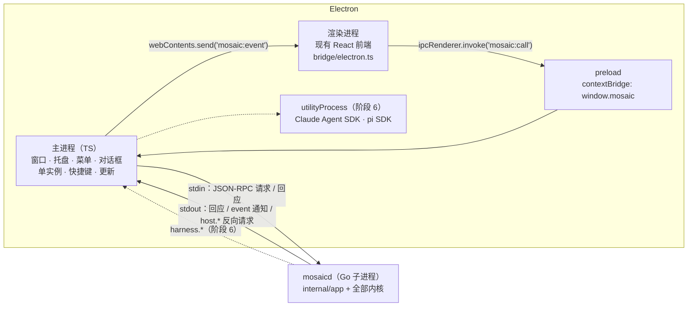

# 用 Electron 重构桌面端：计划

状态：计划已定；**阶段 0（解耦）和阶段 1（最小壳）已实现**，阶段 2 起待做。本文是迁移的依据，与代码不一致时以代码为准。

## 1. 为什么要做

不是因为 Wails 有 bug，而是产品要往这几个方向走，Wails v2 做不到或做起来很别扭：

| 方向 | Wails v2 | Electron |
| --- | --- | --- |
| 接入 Claude Code / pi 等外部 harness（官方 SDK 只有 TS / Python） | 要另外拉一个 Node 进程，用户还得自己装 Node | 主进程就是 Node，SDK 直接跑；Node 随应用发布 |
| 内置可控的浏览器（agent 打开、点击、截图网页，预览自己写的页面） | 系统 WebView 做不到可编程控制 | 嵌入受控的 Chromium（`WebContentsView` + CDP） |
| 托盘、关窗后会话在后台继续、跑完通知 | 没有托盘 | 原生支持 |
| 多窗口（Git、产物预览、单个会话拆出去） | 基本是单窗口 | 原生支持 |
| 全局快捷键、快速提问 | 没有 | 原生支持 |
| 三个平台渲染一致 | WebView2 / WKWebView / WebKitGTK 三套引擎，Linux 有黑窗、WebKitGTK 版本问题 | 同一个 Chromium |

代价（接受）：安装包大约多 70–110MB、内存更高（**未实测**，阶段 2 实测；对照基线：本地交叉编译的 Wails Windows 版 `mosaic.exe` 是 30.4MB，含嵌入的前端）；Windows 从"一个 exe"变成安装包；自动更新要重做。

## 2. 不做什么

- **不把 Go 内核重写成 TS。** 24k 行 Go（harness、厂商适配、MCP、权限、插件、存储、更新校验）和 333 个测试是资产，重写不带来体验或扩展性的收益，只带来回归。Go 编译成独立程序 `mosaicd`，作为 Electron 的子进程运行。
- **不改前端。** 前端只通过 `Backend` 接口（`frontend/src/bridge/types.ts`）和后端通信，Wails 相关的只有 `bridge/wails.ts` 一个文件（275 行）。迁移只新增一个 `bridge/electron.ts`。
- **不改用户数据。** 数据目录 `~/.myllmapp`（`sessions.db`、`settings.json`、插件、ChatGPT 凭据）和钥匙串条目都由同一份 Go 代码读写，没有数据迁移。
- Go 的 CLI（`cmd/cli`）保持不变。

## 3. 目标架构

- 渲染进程：`contextIsolation: true`、`sandbox: true`、`nodeIntegration: false`，只能通过 preload 暴露的 `window.mosaic.call(method, args)` 和 `window.mosaic.onEvent(cb)` 访问后端。主进程只转发方法名在白名单里的调用（白名单 = `mosaicd` 在握手时报告的方法列表）。
- `mosaicd` 不开任何网络端口：和主进程之间只用 stdio。其他本机进程、网页都连不上它。
- 主进程替 Go 做那几件"必须由窗口来做"的事（见 §4.3 的 `host.*`）。

## 4. 协议（阶段 0 已实现：`internal/rpc`、`cmd/mosaicd`）

### 4.1 帧格式

- JSON-RPC 2.0，**一行一条消息**（`\n` 分隔），UTF-8。stdout 只写协议消息，日志一律写 stderr。
- 单条消息上限 64MB（会话历史、图片附件可能很大）。
- stdin 读到 EOF（Electron 主进程退出、崩溃）时，`mosaicd` 取消所有运行中的会话并退出：不会留下孤儿进程。

### 4.2 前端 → Go：调用绑定方法

- 方法名就是 `internal/app.App` 的公开方法名（与 Wails 绑定同名），例如 `GetStatus`、`SendToSession`。
- `params` 是**按位置的数组**，与 Go 方法的参数一一对应；省略的参数按零值处理。返回值：方法返回 `(T, error)` 时 `result` 是 `T`；返回 `error` 时 error 非空就是 JSON-RPC 错误（`code: -32000`，`message` 是错误文本，和 Wails 里 Promise 被 reject 的文本一致）。
- 每个请求在独立的 goroutine 里执行（和 Wails 一样可以并发），回应按完成顺序写出，用 `id` 配对。
- 保留的方法：
  - `rpc.hello` → `{"protocol":1,"event_protocol":1,"version":"1.7.10","methods":[…]}`：握手，主进程据此确认版本并建立白名单；
  - 不可调用：`Startup`、`Shutdown`、`SetHost`、`SetPlugins`、`SetChangelog`、`DisableSelfUpdate` 这些生命周期方法。

### 4.3 Go → Electron

- **事件通知**：`{"jsonrpc":"2.0","method":"event","params":{"name":"agent:event","data":{…}}}`。`data` 就是现在 `agent:event` 的事件信封（21 种类型、带 `seq`），前端代码不变。注意事件由多个 goroutine 发布（agent 循环、回答权限确认的那次调用等），写到 stdout 的顺序不一定等于 `seq` 的顺序，所以前端的 `reorder.ts` 仍然需要（测试里实测到过 seq 16 晚于 18 到达）。
- **反向请求**（Go 等待回应）：
  - `host.openFile`（`{title, default_directory, filters:[{display_name, pattern}]}` → 路径或 `""`）；
  - `host.openDirectory`（`{title, default_directory, can_create_directories}` → 路径或 `""`）；
  - `host.saveFile`（`{title, default_filename, filters}` → 路径或 `""`）。
- **反向通知**（不等回应）：`host.openURL`（`{"url": "https://…"}`，主进程只放行 http / https）、`host.quit`。

这些正好对应现在 `internal/app` 里直接调用 Wails 的 10 处（3 个对话框、4 处打开网址、1 处退出、1 处推事件），阶段 0 把它们都收进了 `app.Host` 接口。

## 5. 分阶段（每一阶段都能独立运行和验证）

### 阶段 0：解耦（已完成）

- `internal/app` 不再 import Wails：桌面能力都走 `app.Host` 接口；Wails 的实现放在仓库根的 `main` 包（`wails_host.go`），行为不变。
- `internal/rpc`：通用的 stdio JSON-RPC 对等端（请求、通知、反向请求，反射分发方法）。
- `cmd/mosaicd`：读配置 → 组装内核 → 在 stdio 上服务 `App` 的全部方法。`InstallUpdate` 在这里被禁用（自更新改由壳负责，见阶段 3）。
- **验证**：现有测试全部通过；`cmd/mosaicd` 的测试用演示厂商通过 stdio 跑完整的一轮（新建会话 → 发消息 → 收事件 → 回答权限确认 → `turn_end`），并覆盖反向请求；`scripts/mosaicd-smoke.mjs` 用 Node 从外部跑同样的流程（这就是 Electron 主进程将来要做的事）；`internal/archtest` 禁止 `internal/` 再导入 Wails。Wails 版照常构建和发布。

### 阶段 1：Electron 最小壳（已完成）

- `desktop/`：`src/main.ts`（窗口、单实例锁、白名单转发、导航限制）、`src/preload.ts`（`window.mosaic`）、`src/sidecar.ts`（拉起 `mosaicd`、握手、白名单、事件、退出）、`src/host.ts`（对话框、打开链接）、`src/rpc.ts`（协议）、`src/smoke.ts`（冒烟）。
- 前端新增 `bridge/electron.ts`，与 Wails 版共用方法映射表（`wails.ts` 的 `createBackendFrom`）；`bridge/index.ts` 在 Electron / Wails / 演示模式里选一个。前端其余代码没改。
- 前端用自定义协议 `mosaic://app/` 提供（不是 `file://`）：构建产物里的资源用绝对路径，而且 ES 模块脚本在 `file://` 下会被当成跨域；自定义协议下有正常的来源。
- 安全：`contextIsolation`、`sandbox`、无 Node；IPC 只接受来自我们自己页面的调用；方法名只放行后端握手时报告的列表；页面里的链接交给系统浏览器（只放行 http / https），窗口不能被导航走。**还没有 CSP**：要等阶段 2 在打包后的页面上逐项验证 mermaid / viz（wasm）/ katex 后再加，避免一刀切把渲染弄坏。
- 开发：`make desktop-install`；`make desktop-start`（先构建前端，后端用 `go run` 或 `MOSAIC_MOSAICD`）；`MOSAIC_DEV_URL=http://localhost:5173` 时连 vite 开发服务器。
- **验证（已完成）**：`desktop` 的单元测试 10 个（协议分片和 U+2028、id 配对、断线、链接白名单、对话框过滤器，以及用真实 `mosaicd` 验证握手、白名单、一轮对话、反向请求、退出和崩溃）；**冒烟测试在真实的 Electron 45（Chromium 156）窗口里**加载前端、渲染出界面、通过 IPC 跑完一轮演示对话（2 次权限确认），并确认生命周期方法被拒绝。CI 的 `desktop` 任务在三个平台跑单元测试，在 Linux 上用 xvfb 跑冒烟。Windows / macOS 上的真实窗口还需要人工验证（对话框、托盘等）。

### 阶段 2：打包与 CI（并行发布）

- `electron-builder`：Windows NSIS 安装包、macOS `.dmg` / `.zip`（universal：两个架构的 `mosaicd` 用 `lipo` 合并）、Linux AppImage。`mosaicd` 放在 `resources/` 下，不进 asar。
- `release.yml` 增加 Electron 产物，**与 Wails 产物并行发布**；Electron 版先以 `-beta` 预发布 tag 发给愿意尝鲜的用户（正式版用户收不到预发布）。
- **验证**：下载三个平台的产物能启动、能对话；实测安装包大小、冷启动时间、空闲和长会话的内存，和 Wails 版对比写进本文。

### 阶段 3：自动更新与从 Wails 迁移

- Electron 版用 `electron-updater`（Windows NSIS、Linux AppImage），**下载后先按现有的 ed25519 签名清单校验 sha256 再安装**——保留现在“只信任内置公钥签过的清单”的安全模型，不因为换壳变弱。macOS 没有签名公证时仍是“提示并打开下载页”（和现在一样）。
- 老用户迁移：最后一个 Wails 版本的清单把所有平台标成“手动更新”，提示下载 Electron 安装包；数据目录和钥匙串不变，装上即用。
- **验证**：Windows / Linux 上从 Electron vX 自动更新到 vX+1；从最后一个 Wails 版换到 Electron 版后会话、设置、插件、登录状态都在。

### 阶段 4：桌面能力

- 托盘：关窗后在后台继续运行会话，完成 / 需要确认时系统通知，点通知回到对应会话。
- 多窗口：Git 窗口、产物预览可以拆成独立窗口（同一个 `mosaicd`，事件按窗口订阅的会话分发）。
- 全局快捷键唤起“快速提问”。
- **验证**：逐项手动验收；托盘和通知在三个平台各测一次。

### 阶段 5：切换

- Electron 成为默认发布；Wails 入口（`main.go`、`wails.json`、`bridge/wails.ts`）在一个过渡版本后删除；文档、截图更新。
- **验证**：连续两个正式版没有 Electron 相关的阻塞问题后再删 Wails。

### 阶段 6（扩展，单独设计）

- **外部 harness**：Go 内核抽出 `Harness` 接口（builtin 就是现在的 agent 循环）；Codex 由 Go 直接接 `codex app-server`；Claude Code、pi 的官方 SDK 跑在 Electron 的 `utilityProcess` 里，通过 `harness.*` 反向请求接回 Go，事件和权限确认照常走 Mosaic 自己的界面。
- **内置浏览器工具**：主进程提供受控的 `WebContentsView`，以 MCP 工具的形式暴露给 agent（打开、截图、点击、读 DOM），每次操作照常走权限确认。

## 6. 风险与对策

| 风险 | 对策 |
| --- | --- |
| 两个进程的生命周期（`mosaicd` 崩溃、Electron 退出后残留） | stdin EOF 即退出；主进程监听子进程退出，自动重启一次并提示；Windows 上用 Job Object 保证进程树随主进程结束（阶段 1） |
| 绑定方法签名变化时前端没跟上 | 握手返回方法列表；`cmd/mosaicd` 的测试检查前端 `bridge/types.ts` 用到的方法在列表里都存在（阶段 1 加） |
| 更新机制变弱 | 保留 ed25519 签名清单校验（阶段 3） |
| 安装包和内存变大 | 阶段 2 实测并记录；按需加载 mermaid / viz 等大依赖（前端已是按需分包） |
| Windows 上 SmartScreen、macOS Gatekeeper | 与换壳无关；代码签名和公证单独决定 |
| 迁移期间两套壳并存的维护成本 | 前端不分叉（同一个 `Backend` 接口），Go 不分叉（同一个 `internal/app`），只有壳是两份；阶段 5 尽快收敛 |

## 7. 估算

按代码规模估（不是实测）：阶段 0 约 4–6 人天（已完成），阶段 1 约 6–9，阶段 2 约 6–9，阶段 3 约 6–10，阶段 4 约 6–10，阶段 5 约 2–3；合计约 30–47 人天。阶段 6 另行评估。
