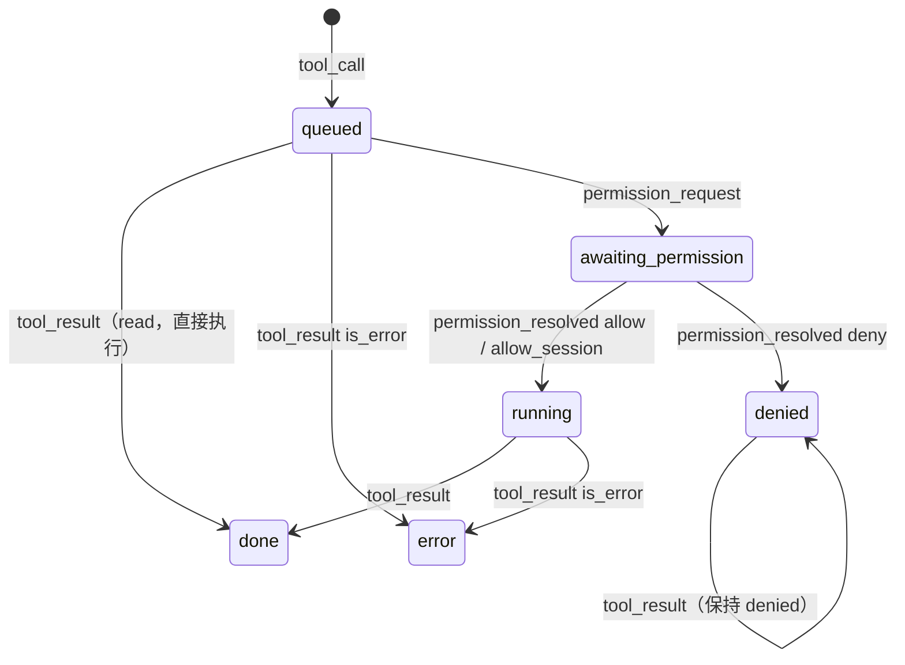

# 设计：前端状态管理（frontend/）

## 目标

- 前端**只认统一事件流**，不感知厂商；
- 流式更新（每秒几十个 delta）时界面流畅；
- 最容易出错的"事件 → 状态"逻辑可以脱离浏览器单独测试；
- 没有 Go 后端时也能运行（浏览器演示、前端开发）。

## 分层

```
components/*.tsx      只读状态 + 调用动作
      │ useChat(selector)
store/chatStore.ts    Zustand：持有状态、订阅事件、提供动作
      │ applyEvent(state, ev)            │ backend().xxx()
store/reducer.ts      纯函数               bridge/        Backend 接口
                                          ├── wails.ts   window.go.app.App.* + EventsOn("agent:event")
                                          └── demo.ts    回放 demo-events.jsonl
protocol/events.ts    事件协议的 TS 镜像
```

## 状态形状

```ts
interface ChatState {
  sessionId: string | null;          // 只处理这个会话的事件
  timeline: TimelineItem[];          // user / assistant / error / notice / turn_end
  tools: Record<callId, ToolView>;   // 工具调用的详细状态
  permissions: PermissionRequest[];  // 待确认队列，弹窗显示第一个
  running: boolean;
  provider, model, sessionUsage;     // 状态栏
  agents, tasks;                     // 预留：子 agent 树、后台任务
}
```

**为什么工具状态单独放在 `tools` 字典里**：一个工具调用会被多个事件更新（`tool_call` → `permission_request` → `permission_resolved` → `tool_result`），后面几个事件不带 `message_id`，只有 `call_id`。assistant 消息的块里只存 `{type: "tool", callId}` 引用。

### 工具状态机



## reducer 的几个要点

- **会话过滤**：`state.sessionId` 已确定时，丢弃其他会话的事件。
- **文本合并**：相邻同类 delta 合并进同一个块（`appendText`），与后端累加器规则一致。
- **不可变更新**：每个事件返回新对象，React/Zustand 据此判断变化。`updateMessage` 从后往前找消息（正在更新的几乎总是最后一条）。
- **`turn_end` 兜底**：把所有还在 `streaming` 的消息标记为结束（被取消时可能没有 `message_end`），清空待确认队列。
- **未知事件忽略**：`isKnownEvent` 在桥接层过滤，reducer 的 `switch` 也不处理未知类型。

## 会话切换的竞态

`LoadSession` 时后端在方法调用**返回之前**就开始推送重放事件。如果等返回后再清空界面，会把重放事件一起清掉。所以 `chatStore.loadSession` **先**把状态重置为目标会话 ID，**再**调用后端；reducer 的会话过滤同时丢弃旧会话的残留事件。

## 组件交互约定

| 组件 | 约定 |
| --- | --- |
| `ThinkingCard` | 默认（"自动"）流式输出时展开、结束后折叠；可在 设置 → 外观 改为总是展开 / 总是折叠；用户手动操作后以用户为准 |
| `ToolCallCard` | 标题显示工具名、关键参数（command/path）、风险标签、状态和耗时；展开看完整参数和结果 |
| `PermissionDialog` | Enter 允许，Esc 拒绝；显示摘要、风险说明、完整参数 |
| `Composer` | 默认 Enter 发送、Shift+Enter 换行，可改为 Ctrl/⌘+Enter 发送（规则在 `store/keys.ts`）；中文输入法选词时的 Enter 不触发发送（`isComposing`）；运行中变成"停止" |
| `MessageList` | 只有用户在底部附近时才自动滚动 |
| `StatusBar` | 一个下拉框同时选择厂商和模型；不可用的配置档置灰并显示原因 |

## 为什么选 Zustand

- API 极小（一个 `create`），不需要 Provider 包裹；
- 组件用 selector 订阅局部状态，流式更新只重渲染真正变化的组件；
- 状态逻辑写成纯函数 reducer 后，store 层只剩"订阅 + 动作"，非常薄。

考虑过 Redux Toolkit（样板代码多）、React Context + useReducer（任何变化都会让所有消费者重渲染，流式场景下性能差）。

## 为什么手写 Wails 桥接

`wails generate module` 会生成 `wailsjs/`，但：没有 Wails 环境（云端 CI、浏览器演示）时前端无法构建；生成的类型把 Go 结构体变成 class，不如手写的 interface 精确。绑定方法只有十来个，手写维护成本很低。

## 浏览器演示模式

`npm run dev` 在浏览器打开时没有 `window.go`，`bridge/index.ts` 自动选用 `demo.ts`：

- 回放 `demo-events.jsonl`（由真实 CLI 录制：`make demo-events`），所以协议和节奏与真实后端一致；
- 文本重新切片带延迟播放；`permission_request` 真的停下来等点击；拒绝时把对应 `tool_result` 改成失败；
- 选择 `fake / echo` 模型时复述输入。

## 测试

`store/reducer.test.ts` 用同一份录制事件流测试：完整还原时间线、运行中的权限队列与拒绝、会话过滤、无思考降级、协议版本提示。
其余纯函数各有测试：ANSI 解析（`ansi.test.ts`）、界面偏好规范化（`uiPrefs.test.ts`）、发送快捷键（`keys.test.ts`）、MCP 表单转换（`mcpForm.test.ts`），
`i18n.test.ts` 扫描组件源码，确认每个 `t("…")` 都有英文翻译。

## 界面偏好与多语言

- **偏好归前端**：[`store/uiPrefs.ts`](../../frontend/src/store/uiPrefs.ts) 定义结构，后端原样保存在 settings.json 的 `ui` 字段（与状态栏配置同一个模式）。
- **主题和尺寸靠根元素**：主题写在 `<html data-theme>` 上，`index.css` 据此切换颜色变量（"跟随系统"时不设属性，由 `prefers-color-scheme` 决定）；
  字号设在根元素的 `font-size` 上，Tailwind 的尺寸都是 rem，整个界面等比缩放；消息区宽度是 CSS 变量 `--content-width`。组件里不需要读这些偏好。
- **多语言**：[`i18n.ts`](../../frontend/src/i18n.ts) 以中文原文为 key 查英文表，`t()` 是普通函数。切换语言时 `App` 用 `key={lang}` 重新挂载界面，
  所有 `t()` 重新求值；状态都在 store 里，不会丢（只有输入框里没发出去的草稿会清空）。
  模块级常量（例如工具状态的标签）只存中文原文，渲染时再 `t()`——模块加载时语言还没确定。
- **会话标题**：`session_updated` 事件不经过 reducer（标题属于会话元数据），由 `chatStore` 更新标题并刷新会话列表。

## 状态栏

- **配置归前端**：显示哪些项、顺序、显示方式由 [`store/statusline.ts`](../../frontend/src/store/statusline.ts) 定义；后端只把它当作不透明的 JSON 存进 settings.json。新增一项只需在 `ITEMS` 里加一条、在 `StatusBar.tsx` 里写渲染，不用改 Go 代码。读回旧配置时 `normalizeConfig` 保留用户的顺序和开关，丢弃未知项，补上新增项。
- **派生数据是纯函数**：上下文占用、预估花费、当前步数在 [`store/metrics.ts`](../../frontend/src/store/metrics.ts)，依赖厂商配置（单价、窗口），所以不放进只认事件的 reducer；有单元测试。
- **上下文** 取最近一次调用的 `input_tokens + output_tokens`（厂商返回的真实值），不是估算。
- **花费** 逐条消息按"当时的厂商和模型"计价，中途换模型也算得对；恢复的历史会话没有逐条用量，退回到"会话累计 × 当前单价"的近似值并标 `+`。
- **实时性**：reducer 在每个 `message_end` 把用量累加进 `sessionUsage`，`turn_end` 再用后端的权威值覆盖；耗时由 `turn_start` 的时间戳计算，组件运行中每秒刷新。
- **脚本输出**：`ScriptItem` 在会话、模型、运行状态、用量变化时（节流到每秒最多一次）和每 15 秒调用 `RunStatusLine`，同一时间只跑一个；
  输出里的 ANSI 颜色由 [`store/ansi.ts`](../../frontend/src/store/ansi.ts) 解析成带样式的片段（支持 16 色、256 色、真彩色、粗体等）。命令本身由后端从设置文件读取。
- **每项可以为空**：组件返回 null 时外层 `.statusline-item:empty` 被隐藏，分隔线用 `:not(:empty) ~ :not(:empty)::before` 绘制，所以关掉的项和暂时没数据的项都不会留下多余的分隔线。
