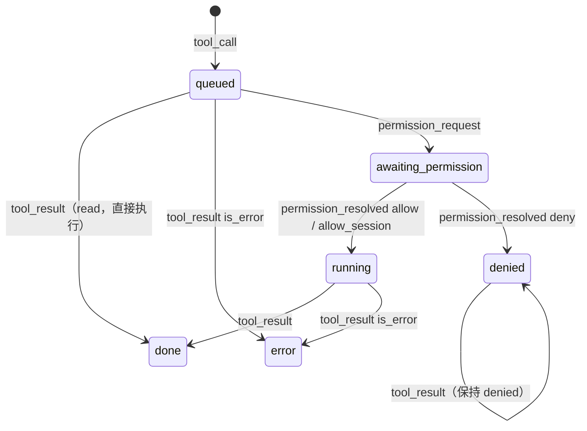

# 设计：前端状态管理（frontend/）

## 目标

- 前端**只认统一事件流**，不感知厂商；
- 流式更新（每秒几十个 delta）时界面流畅；
- 最容易出错的"事件 → 状态"逻辑可以脱离浏览器单独测试；
- 没有 Go 后端时也能运行（浏览器演示、前端开发）。

## 分层

```
components/*.tsx      只读状态 + 调用动作
      │ useChat(selector)
store/chatStore.ts    Zustand：持有状态、订阅事件、提供动作
      │ applyEvent(state, ev)            │ backend().xxx()
store/reducer.ts      纯函数               bridge/        Backend 接口
                                          ├── wails.ts   window.go.app.App.* + EventsOn("agent:event")
                                          └── demo.ts    回放 demo-events.jsonl
protocol/events.ts    事件协议的 TS 镜像
```

## 状态形状

```ts
interface ChatState {
  sessionId: string | null;          // 只处理这个会话的事件
  timeline: TimelineItem[];          // user / assistant / error / notice / turn_end
  tools: Record<callId, ToolView>;   // 工具调用的详细状态
  permissions: PermissionRequest[];  // 待确认队列，弹窗显示第一个
  running: boolean;
  provider, model, sessionUsage;     // 状态栏
  agents, tasks;                     // 预留：子 agent 树、后台任务
}
```

**为什么工具状态单独放在 `tools` 字典里**：一个工具调用会被多个事件更新（`tool_call` → `permission_request` → `permission_resolved` → `tool_result`），后面几个事件不带 `message_id`，只有 `call_id`。assistant 消息的块里只存 `{type: "tool", callId}` 引用。

### 工具状态机



## reducer 的几个要点

- **会话过滤**：`state.sessionId` 已确定时，丢弃其他会话的事件。
- **文本合并**：相邻同类 delta 合并进同一个块（`appendText`），与后端累加器规则一致。
- **不可变更新**：每个事件返回新对象，React/Zustand 据此判断变化。`updateMessage` 从后往前找消息（正在更新的几乎总是最后一条）。
- **`turn_end` 兜底**：把所有还在 `streaming` 的消息标记为结束（被取消时可能没有 `message_end`），清空待确认队列。
- **未知事件忽略**：`isKnownEvent` 在桥接层过滤，reducer 的 `switch` 也不处理未知类型。

## 会话切换的竞态

`LoadSession` 时后端在方法调用**返回之前**就开始推送重放事件。如果等返回后再清空界面，会把重放事件一起清掉。所以 `chatStore.loadSession` **先**把状态重置为目标会话 ID，**再**调用后端；reducer 的会话过滤同时丢弃旧会话的残留事件。

## 组件交互约定

| 组件 | 约定 |
| --- | --- |
| `ThinkingCard` | 流式输出时自动展开，结束后自动折叠；用户手动操作后以用户为准 |
| `ToolCallCard` | 标题显示工具名、关键参数（command/path）、风险标签、状态和耗时；展开看完整参数和结果 |
| `PermissionDialog` | Enter 允许，Esc 拒绝；显示摘要、风险说明、完整参数 |
| `Composer` | Enter 发送、Shift+Enter 换行；中文输入法选词时的 Enter 不触发发送（`isComposing`）；运行中变成"停止" |
| `MessageList` | 只有用户在底部附近时才自动滚动 |
| `StatusBar` | 一个下拉框同时选择厂商和模型；不可用的配置档置灰并显示原因 |

## 为什么选 Zustand

- API 极小（一个 `create`），不需要 Provider 包裹；
- 组件用 selector 订阅局部状态，流式更新只重渲染真正变化的组件；
- 状态逻辑写成纯函数 reducer 后，store 层只剩"订阅 + 动作"，非常薄。

考虑过 Redux Toolkit（样板代码多）、React Context + useReducer（任何变化都会让所有消费者重渲染，流式场景下性能差）。

## 为什么手写 Wails 桥接

`wails generate module` 会生成 `wailsjs/`，但：没有 Wails 环境（云端 CI、浏览器演示）时前端无法构建；生成的类型把 Go 结构体变成 class，不如手写的 interface 精确。绑定方法只有十来个，手写维护成本很低。

## 浏览器演示模式

`npm run dev` 在浏览器打开时没有 `window.go`，`bridge/index.ts` 自动选用 `demo.ts`：

- 回放 `demo-events.jsonl`（由真实 CLI 录制：`make demo-events`），所以协议和节奏与真实后端一致；
- 文本重新切片带延迟播放；`permission_request` 真的停下来等点击；拒绝时把对应 `tool_result` 改成失败；
- 选择 `fake / echo` 模型时复述输入。

## 测试

`store/reducer.test.ts` 用同一份录制事件流测试：完整还原时间线、运行中的权限队列与拒绝、会话过滤、无思考降级、协议版本提示。
