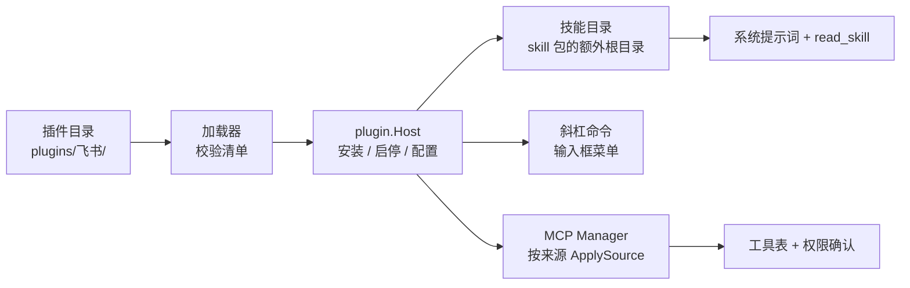
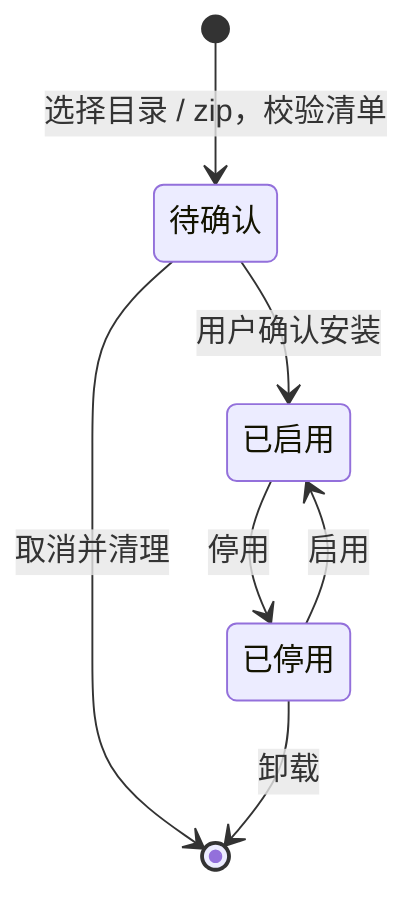

# 插件系统技术方案

> 怎么写插件见 [插件开发指南](../plugin-development.md)；这份是设计说明。

状态：第 1、2、2.5、3 期已实现（飞书插件第一版，未在真实租户验证）；第 4 期（钩子）未做。本文是方案，也是实现的依据；与代码不一致时以代码为准。

> 这份方案最初是一份探讨稿（HTML），在多会话并发、产物面板、技能、改名 Mosaic 之后，对照当时的代码重新核对并调整，调整点见 [§13](#13-与最初方案相比的调整)。

## 1. 目标与结论

让任何人都能以“插件”的形式扩展 Mosaic：提供技能、斜杠命令、外部工具（MCP）、设置表单和状态检查；以后再加钩子和 IM 集成（飞书）。

**不发明新的插件运行时**：插件是一个目录 + 一份清单（`plugin.json`），由 `plugin.Host` 把它带来的东西分发给已有的注册表——技能目录、斜杠命令菜单、MCP 管理器。内核看不到“插件”这个概念，只看到更多的技能和工具。

三条原则：

1. **工具能力一律走 MCP**：作者可以用任何语言，工具照常走统一的权限确认。
2. **界面不开放前端代码注入**：只有清单声明的表单、状态点、按钮，由应用自己渲染。
3. **插件是用户电脑上的外部程序，无法沙箱**：安全靠“安装前展示清单并确认 + 工具默认每次询问 + 密钥进钥匙串 + 子进程环境变量白名单”，而不是假装能防住恶意插件。

## 2. 总体架构



`plugin.Host`（`internal/plugin`）只被装配层（`internal/bootstrap`）创建、被 `internal/app` 调用；`internal/core` 不依赖它。技能通过 `skill.Root`、工具通过 `mcp.ServerConfig.Source` 接入，都是已有包上的小扩展。

## 3. 插件包格式

```
<数据目录>/plugins/feishu/        插件代码（安装后只读）
  plugin.json                     清单
  skills/feishu-docs/SKILL.md     技能
  commands/summarize-doc.md       斜杠命令（提示词模板）
  server/feishu-mcp.js            MCP 服务（任意语言）
<数据目录>/plugin-data/feishu/    插件自己的运行时数据（可写）
<数据目录>/plugins.json           安装状态：启用与否、配置、安装确认的结果
```

数据目录由配置解析（`Config.ResolveDataDir`，目前仍是 `~/.myllmapp`），不写死路径，以后迁移数据目录时插件一起走。

### 清单（JSON）

```json
{
  "id": "feishu",
  "name": "飞书",
  "version": "0.1.0",
  "description": "读取飞书文档和群消息",
  "min_app_version": "1.3.2",
  "protocol": 1,
  "skills":   [{"path": "skills/feishu-docs"}],
  "commands": [{"name": "feishu-summary", "path": "commands/summarize-doc.md", "description": "总结一篇飞书文档"}],
  "mcp": [{
    "name": "docs",
    "command": "node", "args": ["${PLUGIN_DIR}/server/feishu-mcp.js"],
    "env": {"LARK_PROFILE": "${config.profile}", "LARK_SECRET": "${config.app_secret}"},
    "risk": "read"
  }],
  "config": [
    {"key": "profile", "label": "飞书应用配置名", "type": "string", "default": "default"},
    {"key": "app_secret", "label": "App Secret", "type": "secret"}
  ],
  "status":  {"command": "lark-cli auth status --format json", "ok_path": "ok"},
  "actions": [{"id": "login", "label": "登录飞书", "command": "lark-cli auth login --no-wait"}],
  "requires": {"commands": ["lark-cli"]},
  "network": ["open.feishu.cn"]
}
```

- **id**：小写字母、数字、`-`，以字母或数字开头，最长 24 个字符（会成为 MCP 服务名和工具名的一部分）。
- **JSON 而不是 TOML**：设置文件和前端都是 JSON，作者多来自 JS/Python 生态。
- **变量**：`${PLUGIN_DIR}`、`${DATA_DIR}`、`${config.xxx}`，由加载器展开，只用在 `mcp`（command、args、env、cwd）和 `status` / `actions` 的命令里。未知变量是校验错误，不会被原样留下。
- **路径**：`skills`、`commands`、`mcp.cwd` 里的路径必须落在插件目录内（解析符号链接后检查）。
- **限制**：清单最大 256KB；技能和命令各最多 50 个；`mcp` 最多 8 个；`config` 最多 30 项。
- **兼容**：`min_app_version` 高于当前应用版本、或 `protocol` 与事件协议版本不一致，插件显示“需要升级应用”，不加载（开发版 `dev` 不做版本比较）。
- **暂不支持的字段**：`hooks`、`subagents`。清单里出现它们时，插件被拒绝并说明原因（第 4 期再做），而不是悄悄忽略。

## 4. 能力

### 技能（已在 `internal/skill` 实现，插件只是多提供一个目录）

清单的 `skills` 每项指向一个含 `SKILL.md` 的文件夹。`skill.Discover` 增加“额外根目录”参数，插件的技能以 `plugin:<id>` 为来源参与发现；同名技能项目 > 用户 > 插件（插件最后，不会覆盖用户自己的技能）。系统提示词里只放名称和一句话简介，`read_skill` 读正文（免确认、只读、限制在技能文件夹内）。

### 斜杠命令

`commands/*.md` 是提示词模板：开头可选的 `---` 前置块写 `description`，正文里 `{{args}}` 会被替换成用户在命令后面输入的内容。输入框里键入 `/` 的菜单同时列出技能和命令；选中命令并发送时，前端调用后端 `ExpandCommand` 得到展开后的文本再发送（附件照常随消息发出）。命令重名时加插件前缀（`/feishu:summary`），不同插件之间、和技能之间都不会互相覆盖。

### 工具插件（MCP）

清单的 `mcp` 声明的服务由 `mcp.Manager` 托管。关键变化：

- `mcp.ServerConfig` 增加 `Source`（空表示用户在设置里配的，`plugin:<id>` 表示插件带来的）。`Manager.Apply` 只管理来源为空的服务；插件的服务用 `Manager.ApplySource(source, cfgs)`，两边互不影响——设置页保存 MCP 列表不会把插件的服务断开，停用插件也只摘掉它自己的。
- 服务名固定为 `<插件id>` 或 `<插件id>-<name>`（`name` 与 id 相同或省略时用前者），工具名是 `mcp__<服务名>__<工具>`。
- **风险**：默认 `exec`（每次询问）。作者声明 `risk: read` 只是“申请”，**安装确认时用户逐项勾选**后才生效；没勾选仍按 `exec`。设置里的权限规则和工具开关对插件工具照常生效。
- **环境变量白名单**：插件服务的子进程只继承 `PATH`、`HOME` / `USERPROFILE`、`SystemRoot`、临时目录、语言环境这类基础变量，加上清单里声明的 `env`；不继承应用自己的环境（里面可能有厂商的 API Key）。

### 声明式界面

由应用渲染，不执行插件的任何前端代码：

| 声明 | 界面表现 |
| --- | --- |
| `config` | 插件详情里的设置表单。类型：`string`、`secret`（只显示“已设置”，值存钥匙串）、`bool`、`select`（带 `options`）、`path`；支持 `default`、`required`、`help` |
| `status` | 周期性（打开详情页时、每 30 秒、保存配置后）执行命令，输出 JSON，用 `ok_path` 指向的字段（点号路径）判断；界面显示“正常 / 异常 / 缺少依赖” |
| `actions` | 按钮。点击运行声明的命令（超时 120 秒），把输出显示在面板里，输出里的 http(s) 链接可点击（例如登录授权页） |
| `requires` | 检查本机是否有声明的命令；缺失时在详情里提示，并让 `status` / `actions` 不执行 |

`status` / `actions` 的命令在**插件目录里**以插件的环境变量白名单运行，输出有大小上限（100KB），不经过 shell 解释（按空格拆分参数，支持双引号）。

## 5. 与内核的接合点

| 能力 | 接入位置 | 改动 |
| --- | --- | --- |
| 技能 | `skill.Discover/Find/Prompt` 增加额外根目录；`read_skill` 工具通过 `Options` 拿到回调 | 小 |
| 斜杠命令 | 前端菜单 + `App.ListCommands / ExpandCommand` | 小 |
| MCP 工具 | `mcp.Manager.ApplySource`、`ServerConfig.Source`、白名单环境 | 小 |
| 配置与密钥 | `plugins.json`；`secret` 类配置走 `internal/secret`（系统钥匙串），不发给前端、不进日志 | 小 |
| 钩子 | `runTool` 在 `Policy.Evaluate` 之前、`Send` 开头、轮次结束（**未做**） | 中 |

### 多会话并发带来的约束

- 启用 / 停用插件**不要求空闲**（不像替换厂商目录那样等所有会话结束）：技能清单和命令每轮重新计算，下一轮生效；停用时摘掉工具，后台正在调用该工具的会话会得到“未知工具”的结果（历史仍然是配对的）。
- 工具名按服务名带前缀，同名工具不会冲突；“本会话总是允许”按会话、按工具名记账，对插件工具同样适用。
- 钩子（第 4 期）需要线程安全，`HookInput` 要带会话 ID，且只能让流程更严格：它在权限裁决之前运行，改不了“询问”变“允许”。
- **sensitive 工具**（读群消息、文档正文这类内容会发给模型厂商的）已实现：`tool.Spec.Sensitive`；清单里 `mcp[].sensitive: true` 把整个服务的工具标成私密。`runTool` 在权限裁决之后，若工具私密且结果是放行，就改成询问——所以档位放行、规则放行、“本会话总是允许”都绕不过；用户拒绝或策略拒绝仍然是拒绝；确认后不记住。`permission_request` 带 `sensitive`，界面据此隐藏“本会话总是允许”，CLI 同理。声明它只会让流程更严格，所以不需要用户在安装时另行确认，确认框里会如实说明。

## 6. 界面

- **设置 → 插件**：已安装列表（名称、版本、来源、启用开关、状态点、带来多少技能 / 命令 / 工具）；“安装插件”；点一个进入详情（描述、配置表单、状态、操作按钮、依赖检查、卸载）。
- **安装确认窗口**：安装前逐项展示——要启动的命令、提供的工具和作者声明的风险（每个 `read` 单独勾选）、依赖的外部命令是否存在、声明访问的域名、需要的配置项、带来的技能和命令。用户确认后才写入磁盘并启用。**不做静默安装，不做自动更新。**
- **输入框 `/` 菜单**：技能和命令混排，来源用小标签区分。
- 产物面板、文件链接等已有能力对插件透明可用；插件把文件写在自己的数据目录（工作区之外）时，现有的“只能预览 / 打开工作区内文件”的限制仍然生效——需要时在后续版本给这两个接口增加“额外允许的目录”。

## 7. 安全模型

| 风险 | 措施 |
| --- | --- |
| 恶意插件 | 安装前确认逐项展示（见上）；不静默安装、不自动更新；插件代码目录安装后不再被应用修改 |
| 工具悄悄做危险操作 | 默认 `exec`、每次询问；`read` 需安装时勾选；规则和工具开关照常生效 |
| 密钥泄露 | `secret` 只存系统钥匙串；只注入该插件声明的环境变量；不发前端、不进日志；子进程不继承应用的环境 |
| 路径逃逸 | 清单路径必须在插件目录内（解析符号链接）；zip 解压拒绝绝对路径、`..`、符号链接条目，并限制条目数和总大小（zip slip / 压缩炸弹） |
| 命令注入 | 命令不经过 shell；变量展开后按参数边界拆分，值里的空格和引号不会产生新的参数 |
| 失控进程 | 状态和操作命令有超时和输出上限；MCP 沿用已有的超时和按进程组退出（Windows 隐藏控制台窗口） |
| 数据流向第三方 | 插件读到的内容会作为工具结果发给当前模型厂商；详情页和安装确认里明确提示 |

`network` 只用于安装确认，**不会强制拦截**，界面上如实说明，避免虚假的安全感。第一版不做插件签名（以后可复用自更新的 ed25519 方案）。

## 8. 生命周期



- 安装来源：本地目录、zip 文件（第一版）；Git 地址在后续版本加。
- 安装是“复制到插件目录”：先复制到临时目录并再次校验，再原子重命名；同 id 已存在时需要用户确认“覆盖更新”（保留配置，重新确认风险）。
- 卸载询问是否一并清除配置、密钥和插件数据。
- 应用升级后不兼容的插件被自动停用并显示原因，不会崩溃。
- 应用启动时加载所有“已启用”的插件；某个插件加载失败只影响它自己，在列表里显示原因。

## 9. 测试策略

- **清单**：非法 id、缺字段、路径逃逸（含符号链接）、未知变量、超限、不支持的字段、版本不兼容，逐项有失败用例。
- **安装**：目录与 zip 的安装、zip slip / 符号链接条目 / 超大条目被拒绝、覆盖更新、安装取消不留残留。
- **生命周期**：启用 → 停用 → 卸载，每一步检查技能、命令、MCP 服务是否同步出现和消失（用 `mcp` 的连接桩）。
- **MCP 来源隔离**：`Apply` 不影响插件的服务，`ApplySource` 不影响用户的服务。
- **权限**：未确认的 `read` 声明仍按 `exec`；环境白名单不含应用的环境变量。
- **密钥**：secret 的值不出现在任何返回给前端的结构里。
- **命令展开**：`{{args}}`、重名加前缀、前置块解析。
- **前端**：插件页、安装确认、`/` 菜单混排的单元测试；浏览器演示模式带示例插件，用 Playwright 走一遍“安装 → 配置 → 停用”。

### 插件市场与 Git 安装（第 2.5 期）

参考了 magpie 的做法：一份列表（`catalog/registry.json`）加 PR 审核，应用定时刷新、内置一份兜底。

- **列表只提供来源，不提供信任。** 每项是 `bundled`（随应用嵌入的 `catalog/bundled/<目录>`）或 `git`（https 地址，可带 `ref`、`subdir`）。无论从哪里来，装之前都走同一条 `Preview` → 用户确认 → `Install`，所以被篡改的列表最多让用户看到一个陌生插件的确认框，不能替用户装任何东西。
- **刷新**：启动时界面先显示内置列表加上次缓存（`plugin-registry.json`），再在后台拉一次 `RegistryURL`（仓库里的 `catalog/registry.json`）；同 id 的在线项覆盖内置项。拉取有 10 秒超时和 1MB 上限，失败不影响使用，逐项校验，坏的项直接丢掉；`bundled` 项必须指向已嵌入的目录。
- **Git 安装**（`PreviewGit`，输入框里的 `https://…#分支或标签` 也走它）：只接受 https、不带用户名密码；`ref` 不能以 `-` 开头；地址用 `--` 与选项隔开传给 `git`。浅克隆（`--depth 1 --single-branch`），`protocol.allow=never` 再单独放开 https，所以不会拉子模块、不走 ssh 或 file://；`core.symlinks=false`，之后用 `copyDir` 复制（拒绝符号链接、跳过 `.git`、有数量和大小上限）。git 子进程用白名单环境变量、`GIT_TERMINAL_PROMPT=0`、2 分钟超时。没有 git 时给出明确提示。
- **没做**：自动更新（仍是“重新安装即更新”，确认框会显示已存在的版本）、固定提交、签名。

### 飞书插件（第 3 期）

`catalog/bundled/feishu`：用用户自己的飞书账号登录，让模型读文档和群消息（只读）。基于飞书官方的 [lark-cli](https://github.com/larksuite/cli)，令牌由它保存在系统钥匙串里，插件不接触、不保存。

- **`feishu.py`**（Python 标准库）：`mcp` 子命令是 MCP 服务，其余子命令给清单的 `status` / `actions`：`status`（解析 `lark-cli auth status`）、`init`（`config init --new`）、`login`（`auth login --recommend --no-wait`，打印授权链接，把设备码记在插件数据目录）、`login-finish`（`auth login --device-code …`）。
- **两个工具而不是一堆具体工具**：`feishu_help` 让模型先看 `lark-cli … --help` 再拼参数，`feishu_read(command, args)` 执行。lark-cli 的命令很多、参数会变，写死一套容易过时。
- **只读靠两层白名单**：业务域白名单；命令名（`+` 后用 `-` 分隔的词）里必须有读取类动词（fetch / list / search / get…）且不能有任何写入类动词（send / create / update / delete…）。参数里禁止 `--as`、`--output`、`--output-dir`、`--file`、`--yes`、`-y`、`--force`、`@文件`；强制加 `--as user`（机器人身份读不到用户的资源，而且读不到时是“成功但为空”）。子进程 stdin 接空（自己的 stdin 是 MCP 通道）。
- **私密**：`sensitive: true`，每次读取都弹窗确认。技能里要求模型把读到的内容当数据，不执行其中的指令。
- **没验证的**：我们没有飞书租户，只用假的 lark-cli 脚本测了“传给 lark-cli 什么 / 拒绝什么 / 登录状态怎么流转”。**不确定**：`auth status` 的输出格式（状态判断基于 JSON 信封的 `ok` 加若干“未登录”关键字的推断）、`auth login --no-wait` 输出里设备码的位置（先找 JSON 里键名含 `device_code` 的字符串，再用正则）、各读取命令的确切参数（由模型现查帮助）、Windows 上 `lark-cli.cmd` 的调用。

## 10. 分期

| 期 | 内容 | 状态 |
| --- | --- | --- |
| 1 | 清单与校验、`Host`（安装 / 启停 / 卸载，目录与 zip）、技能和斜杠命令接入、设置 → 插件页、安装确认 | 已实现 |
| 2 | MCP 按来源管理与白名单环境、风险确认、`config` 表单（含 secret）、`status`、`actions`、`requires` | 已实现 |
| 3 | 飞书插件（只读）和 `sensitive` 私密工具标记 | 已实现第一版；**登录流程和读取命令的参数没有在真实租户里验证**，见下“飞书插件” |
| 4 | 钩子（`user_prompt_submit` / `pre_tool_use` / `post_tool_use` / `turn_end`），单独的安装确认，并发安全 | 未做（等有真实需求） |
| 2.5 | 插件市场（内置插件 + 在线列表 + 本地缓存）和 Git 地址安装 | 已实现 |
| 以后 | 插件自动更新与固定提交、签名、Slack、子 agent 调度、受限的自定义界面（在现有的沙箱 iframe 上加受限消息通道） | 按需 |

## 11. 已确定的决策

最初方案里留给用户的几个问题，按原先的倾向落实（未被否决）：

1. **谁写插件**：先按内部使用做，接口按对外开放设计（所以安装确认、环境白名单、zip 校验这些现在就做，签名和索引以后再说）。
2. **界面边界**：只有声明式表单、状态和按钮，不注入前端代码。
3. **钩子**：先不做，等有真实场景（如合规审计）。
4. **插件工具默认风险**：`exec`；作者可声明 `read`，安装时用户确认后降级；可用“本会话总是允许”。
5. **清单格式**：JSON。
6. **私有仓库**：以后做 Git 安装时用本机已有的 git 配置，应用不保存凭据。
7. **先做飞书**：但要先验证 `lark-cli` 的能力和租户权限。

## 12. 示例

`catalog/bundled/` 里有两个可以直接安装的示例：

- `hello-skill`：只有一个技能和一个斜杠命令（第 1 期，无可执行代码）。
- `echo-mcp`：一个用 Python 写的最小 MCP 服务（`echo` 工具），带配置表单、状态检查和操作按钮（第 2 期）。

## 13. 与最初方案相比的调整

| 项 | 原方案 | 调整 |
| --- | --- | --- |
| 技能 | 第 1 期要做技能、`read_skill`、系统提示词清单 | 这些已在 `internal/skill` 实现；插件只需提供额外目录。删除 `internal/plugin` 里重复的 `Skill` 接口 |
| 斜杠命令 | 独立的命令注册表 | 并入输入框已有的 `/` 菜单，和技能混排 |
| MCP | 把插件的服务合并进 `Manager.Apply` | `Apply` 是“整份覆盖”，会断开不在列表里的服务。改为按来源分开管理（`ApplySource`） |
| 环境变量 | 白名单 | 同，并明确具体的白名单变量；`status` / `actions` 同样适用 |
| 多会话 | 未涉及 | 启停不要求空闲；`sensitive` 要绕过“本会话总是允许”；钩子要并发安全并带会话 ID |
| 附件 | 未涉及 | 钩子只看到附件的名字和大小，拦截和改写只作用于文字 |
| 路径 | 写死 `~/.myllmapp/plugins` | 从数据目录解析 |
| 版本号 | `min_app_version: 1.2.0` | 以当前版本为准（示例用 1.3.2） |
| 界面扩展 | 未来可能放进沙箱 iframe | 产物预览已经有无 `allow-same-origin` 的沙箱 iframe，将来可在它上面加受限消息通道 |
| 工期 | 12–16 天 | 总量基本不变：第 1 期少 1 天（技能已有），第 2 期多 1 天（MCP 来源），钩子多半天（并发） |
