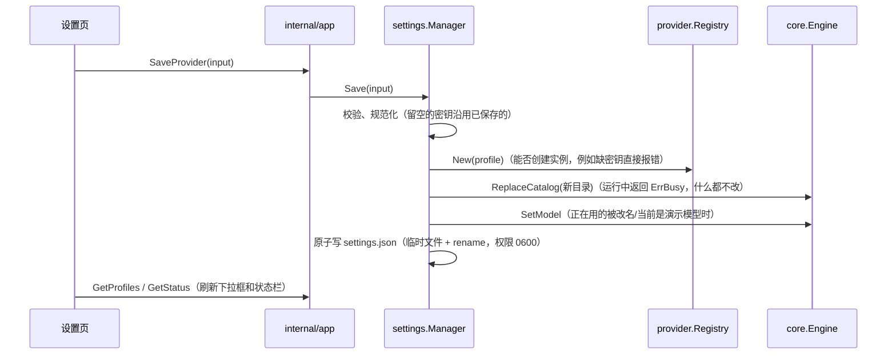
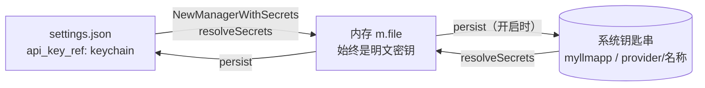

# 设计：界面配置厂商（internal/settings）

## 目标

不改任何文件、不重启，在界面上填 Base URL + API Key 就能接入一个真实模型；同时不破坏"手写 config.toml"这条路。

## 两层配置

| 层 | 文件 | 谁写 | 适合 |
| --- | --- | --- | --- |
| 配置文件 | `config.toml`（或内置默认配置） | 人手写 | 版本管理、团队共享（密钥放环境变量） |
| 界面设置 | `{data_dir}/settings.json` | 程序写 | 本机私有，含密钥 |

**程序永远不改写 config.toml**：TOML 库写回会丢掉注释和格式；而且 config.toml 可能在仓库里，不适合存密钥。

合并规则（[`merge.go`](../../internal/settings/merge.go)）：

- 按配置文件顺序列出；同名时用界面设置**覆盖**，位置不变；界面新增的追加在后面；
- 覆盖时界面上没填密钥，沿用配置文件解析出的密钥（例如配置文件用 `api_key_env`，界面上只改了模型列表）；
- 每个配置档带 `source`：`config` / `settings` / `override`。`config` 的删不掉（要改 config.toml），`override` 的"删除"等于恢复配置文件版本。

## 修改如何立即生效

先替换 Engine 的目录、再写文件：如果 Engine 正忙就什么都不改；反过来会出现"文件已改、运行中的没改"的不一致。

`core.Engine.ReplaceCatalog` 是内核为此新增的唯一方法：替换目录，当前配置档不存在或不可用时回落到第一个可用的。

## 记住选择

界面（和 CLI 的 `/model`）切换模型时调用 `Manager.Select`，把选择写进 settings.json。启动时 `bootstrap.pickDefault` 的优先级：上次的选择 > config.toml 的 `default_provider` > 第一个可用的。选中的不可用时继续往后找，不会因此启动失败。

## 获取模型列表与测试连接

- 获取模型列表：适配器实现可选接口 `provider.ModelLister`（OpenAI 兼容：`GET /models`；Anthropic：`GET /v1/models`）。用可选接口而不是加进 `Provider`，因为不是每个厂商都有这个接口。
- 测试连接：用表单里的配置直接创建一个 Provider，发一条 "Reply with exactly: OK"，返回耗时和回复。不保存任何东西。

两者都直接使用表单里的值（未保存的也行），所以可以"先测通再保存"。

## 密钥

- 默认在 settings.json 中明文保存，文件权限 0600，位于用户主目录下的数据目录，不在仓库里；
- 发给前端的 `ProviderView` 只有 `has_api_key` 和掩码 `api_key_hint`，没有明文；编辑时前端不回传密钥，留空表示沿用；
- 可选保存到系统钥匙串（[`keychain.go`](../../internal/settings/keychain.go)，存储实现在 [`internal/secret`](../../internal/secret/secret.go)）。

### 钥匙串

设计要点是**只在两个边界上转换**，其余代码完全不知道钥匙串的存在：

- 读：启动时把 `"api_key_ref": "keychain"` 换成真正的密钥；读不出来的（钥匙串锁定、不可用）记在 `unresolved` 里；
- 写：所有写盘都经过 `persist`。开启时先写钥匙串、再写文件（只留引用）、最后删掉不再需要的条目——任何一步失败，磁盘上都是一致的；
- `unresolved` 的条目在之后的保存中**保留引用**，不会因为一次读取失败就把用户的密钥弄丢；用户重新填写密钥或删除厂商后才移除；
- 探测钥匙串是否可用（写入、读回、删除一个探测条目）只做一次，避免某些系统反复弹授权框。

## 权限规则、工具开关、MCP、状态栏脚本

都在 [`extras.go`](../../internal/settings/extras.go)，模式相同：校验 → 应用到运行中的组件 → `persist` → 更新内存。

| 字段 | 运行中的组件 | 说明 |
| --- | --- | --- |
| `permission_rules` | `permission.RulePolicy`（bootstrap 把它包在档位策略外面） | 一条不合法就整体拒绝，原规则不变 |
| `disabled_tools` | `core.Engine.SetDisabledTools` | 从下一次模型调用开始生效；名字不存在也允许（例如暂时没连上的 MCP 工具） |
| `mcp_servers` | `mcp.Manager.Apply` | 只重连改动过的 server；连接在后台进行 |
| `statusline_script` | `plugin.CommandStatusLine` | 运行时只从设置文件读取命令，前端只能传附加信息，不能让后端执行任意命令；"试运行"例外，它执行的就是用户正在编辑的命令 |
| `ui` | —（纯前端） | 与 `statusline` 一样原样保存，字段由前端定义 |

## 其他保存在 settings.json 里的东西

- `general`：设置 → 常规 / 系统提示词（工作区、最大步数、输出上限、命令超时、系统提示词）。零值表示"未设置，沿用默认"。
  生效规则在 [`general.go`](../../internal/settings/general.go) 的 `ResolveGeneral`：命令行 > 界面 > config.toml > 内置默认；
  bootstrap 启动时和界面保存时用的是同一个函数。保存时先校验（工作区必须是已存在的目录、数值有上限），
  再调用 `core.Engine.UpdateRuntime`（运行中返回 ErrBusy，什么都不改），再修改 shell 工具的超时，最后写文件。
  默认系统提示词由内核（`core.DefaultSystemPrompt`）在每轮开始时按当前工作区生成，所以换工作区后提示词自动跟随。
- `permission_mode`：状态栏上切换的权限模式（启动时优先级：命令行 `-mode` > 这里 > config.toml；`auto` 不会写进这里，旧文件里的 `auto` 也会被忽略）；
- `statusline`：状态栏配置。后端不解析，原样保存（大小上限 64KB，必须是 JSON 对象），字段由前端定义，见 [前端状态管理](frontend-state.md#状态栏)；
- `ui`：界面偏好（设置 → 外观），同上；
- `general.title_mode`：会话标题由模型生成时，引擎在第一轮正常结束、保存会话之后，在后台用同一个模型再发一次很短的请求（只带第一句提问和最后一段回答），成功后保存并发出 `session_updated` 事件。

## 测试

[`manager_test.go`](../../internal/settings/manager_test.go) 用 httptest 模拟 OpenAI 兼容服务：获取模型列表、测试连接不落盘、保存后自动从演示模型切换并持久化、重新加载后仍在、密钥掩码、文件权限、编辑时沿用密钥、改名时当前会话跟随、覆盖配置文件并恢复、校验、无密钥的本地服务。
另外用 `wails dev` + Playwright 对真实 Go 后端做过端到端验证。
