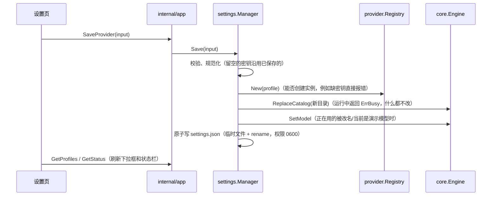

# 设计：界面配置厂商（internal/settings）

## 目标

不改任何文件、不重启，在界面上填 Base URL + API Key 就能接入一个真实模型；同时不破坏"手写 config.toml"这条路。

## 两层配置

| 层 | 文件 | 谁写 | 适合 |
| --- | --- | --- | --- |
| 配置文件 | `config.toml`（或内置默认配置） | 人手写 | 版本管理、团队共享（密钥放环境变量） |
| 界面设置 | `{data_dir}/settings.json` | 程序写 | 本机私有，含密钥 |

**程序永远不改写 config.toml**：TOML 库写回会丢掉注释和格式；而且 config.toml 可能在仓库里，不适合存密钥。

合并规则（[`merge.go`](../../internal/settings/merge.go)）：

- 按配置文件顺序列出；同名时用界面设置**覆盖**，位置不变；界面新增的追加在后面；
- 覆盖时界面上没填密钥，沿用配置文件解析出的密钥（例如配置文件用 `api_key_env`，界面上只改了模型列表）；
- 每个配置档带 `source`：`config` / `settings` / `override`。`config` 的删不掉（要改 config.toml），`override` 的"删除"等于恢复配置文件版本。

## 修改如何立即生效

先替换 Engine 的目录、再写文件：如果 Engine 正忙就什么都不改；反过来会出现"文件已改、运行中的没改"的不一致。

`core.Engine.ReplaceCatalog` 是内核为此新增的唯一方法：替换目录，当前配置档不存在或不可用时回落到第一个可用的。

## 记住选择

界面（和 CLI 的 `/model`）切换模型时调用 `Manager.Select`，把选择写进 settings.json。启动时 `bootstrap.pickDefault` 的优先级：上次的选择 > config.toml 的 `default_provider` > 第一个可用的。选中的不可用时继续往后找，不会因此启动失败。

## 获取模型列表与测试连接

- 获取模型列表：适配器实现可选接口 `provider.ModelLister`（OpenAI 兼容：`GET /models`；Anthropic：`GET /v1/models`）。用可选接口而不是加进 `Provider`，因为不是每个厂商都有这个接口。
- 测试连接：用表单里的配置直接创建一个 Provider，发一条 "Reply with exactly: OK"，返回耗时和回复。不保存任何东西。

两者都直接使用表单里的值（未保存的也行），所以可以"先测通再保存"。

## 密钥

- settings.json 明文保存，文件权限 0600，位于用户主目录下的数据目录，不在仓库里；
- 发给前端的 `ProviderView` 只有 `has_api_key` 和掩码 `api_key_hint`，没有明文；编辑时前端不回传密钥，留空表示沿用；
- 后续计划改存系统钥匙串，见 [roadmap](../roadmap.md)。

## 测试

[`manager_test.go`](../../internal/settings/manager_test.go) 用 httptest 模拟 OpenAI 兼容服务：获取模型列表、测试连接不落盘、保存后自动从演示模型切换并持久化、重新加载后仍在、密钥掩码、文件权限、编辑时沿用密钥、改名时当前会话跟随、覆盖配置文件并恢复、校验、无密钥的本地服务。
另外用 `wails dev` + Playwright 对真实 Go 后端做过端到端验证。
