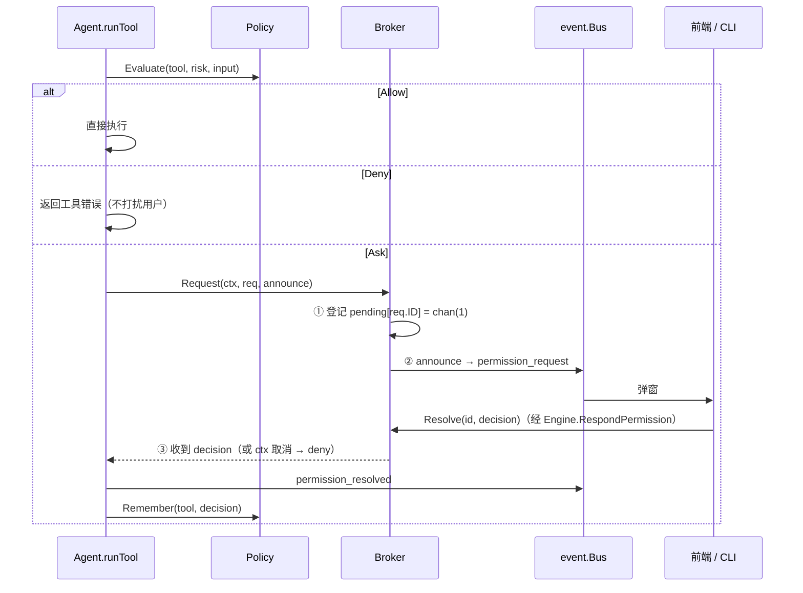

# 设计：工具与权限（internal/tool、internal/permission）

## 目标

- 工具作者只关心"做什么"，不关心 UI 和权限流程；
- 危险操作（写文件、执行命令）在执行前必须得到用户确认；
- 确认过程不依赖任何具体 UI，内核可以在测试里被"自动应答"驱动。

## 工具接口

```go
type Tool interface {
    Spec() Spec                             // 名称、描述、JSON Schema、风险等级
    Summarize(input json.RawMessage) string // 一句人话，用于权限弹窗和卡片标题
    Execute(ctx context.Context, call Call) Result
}
```

- **风险等级由工具声明**（`read` / `write` / `exec`），是否需要确认由策略决定。
- **失败用 `Result{IsError: true}` 表达**，而不是 Go error：模型需要看到失败原因才能调整。
- **JSON Schema 手写**：schema 是写给模型看的"文档"，手写能精确控制措辞；反射生成还需要额外依赖。
- **`Summarize` 由工具实现**：只有工具知道哪个参数是关键信息（路径、命令）。

### 内置工具

| 工具 | 风险 | 免确认 | 说明 |
| --- | --- | --- | --- |
| `read_file` | read | ✅ | `offset`/`limit` 分段读，默认最多 2000 行 / 100KB，部分读取时注明总行数；拒绝二进制 |
| `list_dir` | read | ✅ | 目录在前、按名称排序；`recursive` + `max_depth`（默认 2）；`include_hidden` |
| `find_files` | read | ✅ | glob（`*.go`、`src/**/*.ts`），默认最多 200 个 |
| `search_content` | read | ✅ | Go 正则，`path:行号: 内容`，`glob` 过滤、默认不区分大小写、最多 100 处，多核并行扫描；超出时注明"已截断，共 N 处" |
| `git_status` / `git_diff` / `git_log` | read | ✅ | 结构化参数，不拼命令行，模型无法借机执行写操作 |
| `todo_write` / `todo_read` | read | ✅ | 按会话保存在内存中的任务清单 |
| `edit_file` | write | ❌ | 精确替换；0 处报"未找到"，多处要求加上下文或 `replace_all`；保留 CRLF；返回 +X/-Y 行和位置 |
| `write_file` | write | ❌ | `mode=overwrite`（默认）/ `append`，自动创建父目录 |
| `mkdir` / `move_file` | write | ❌ | 移动时目标已存在则拒绝 |
| `delete_file` | write | ❌ | 移到 `.myllmapp/trash/<时间>/原路径`，可找回 |
| `shell` | exec | ❌ | `sh -c`（Windows 为 `cmd /S /C`，命令行用 `SysProcAttr.CmdLine` 原样传入，不经 Go 的参数转义；输出按行判断编码，非 UTF-8 的行按系统 OEM 代码页转成 UTF-8；系统提示词和工具描述里说明 shell 种类、每次调用是新进程）；`cwd`（相对工作区）、`timeout_seconds`（默认 60，最大 600），超时返回已有输出；取消时杀进程组 |

"免确认"指默认权限档位；`accept_edits` 档位下 write 风险也免确认，`readonly` 档位下 write/exec 一律拒绝。

**公共约定**（`internal/tool/builtin`）：

- **统一截断**：所有输出上限 100KB，超出时注明截断了多少。
- **统一忽略规则**（`ignore.go`）：先看工作区根目录的 `.gitignore`（常用子集），再套内置黑名单（`.git`、`node_modules`、`dist`、`build`、`target`、`.venv`、`__pycache__`、`.myllmapp` 等）。search_content、find_files、递归 list_dir 共用。
- **可操作的错误信息**：例如"未找到文件 X，建议先用 find_files 确认路径"，让模型知道下一步做什么。
- **危险命令黑名单**（`danger.go`）：`rm -rf /`、mkfs / format、shutdown、`git push --force`、`curl | sh` 等在任何权限档位下都直接拒绝。这只是拦住"手滑"，不是安全边界。
- **项目说明**：工作区里的 `.myllmapp/context.md` 每轮追加到系统提示词末尾（上限 16KB），用来写项目约定。

所有路径通过 `resolvePath` 限制在工作区内（拒绝 `..`、工作区外的绝对路径，以及经符号链接指向工作区之外的路径）。**这只是防误操作，不是安全沙箱**——shell 工具可以做任何事，这正是它每次都需要确认的原因；检查与使用之间的竞态（TOCTOU）也没有处理。

## 权限：策略 + 会合点



### 策略（Policy）

内置的 `ModePolicy` 有四种模式（参考 Claude Code 的权限模式），从保守到放开：

| 模式 | 界面名称 | read | write | exec |
| --- | --- | --- | --- | --- |
| `readonly` | 只读 | 放行 | 拒绝 | 拒绝 |
| `default` | 默认 | 放行 | 询问 | 询问 |
| `accept_edits` | 自动接受编辑 | 放行 | 放行 | 询问 |
| `auto` | 全部放行 | 放行 | 放行 | 放行 |

启动时的模式来自配置文件的 `permission_mode`（CLI 可用 `-mode` 覆盖）。运行期间可以随时切换：桌面端在状态栏选择，CLI 用 `/mode <mode>`。切换通过可选接口 `permission.ModeController` 实现，立即生效——策略在每次工具调用前才被询问，所以本轮里还没执行的调用也会按新模式处理；已经弹出的确认请求仍需回答。切到 `auto` 前，桌面端会弹出危险确认（不提供 Enter 快捷确认，默认焦点在"取消"）。

切换会被记住（`settings.json` 的 `permission_mode`，优先于配置文件），**`auto` 除外**：它只对本次运行生效，文件里保留切换前的档位；启动时即使读到旧版本写入的 `auto` 也会忽略。否则某次临时开了全部放行，之后每次启动都会在不知不觉中不经确认地执行命令。想默认就全部放行，只能在 config.toml 或 `-mode auto` 中明确指定。

用户选择"本会话总是允许"（`allow_session`）后，同名工具在本会话内不再询问；`NewSession` / `LoadSession` 时 `Reset`。未知模式回落到 `default`——宁可多问一次。

### 规则（RulePolicy）

档位是"一刀切"的。[`rules.go`](../../internal/permission/rules.go) 的 `RulePolicy` 包在档位策略外面，按工具名和参数做更细的裁决：

```go
policy := permission.NewRulePolicy(permission.NewModePolicy(mode), rules) // bootstrap 中
```

- 一条规则 = 工具名（支持 `*`）+ 匹配内容 + 动作（allow / ask / deny）；从上到下第一条匹配的生效，都不匹配时交给档位；
- 匹配内容对照的是工具参数里的 `command`、`path`、`url`（依次取第一个存在的），都没有时对照整个参数 JSON；
  这样内置工具和大多数 MCP 工具都能按"命令 / 路径 / 地址"写规则，而不需要为每个工具写匹配器；
- `*` 可以跨越 `/`（`src/*` 匹配 `src/a/b.go`）：规则是给人手写的，按 glob 的"`*` 不跨目录"语义反而容易写漏；
- **规则优先于档位**：`deny` 在 `auto` 下也生效（"全部放行，但永远不许 rm"），`allow` 在 `readonly` 下也生效；
- 切换档位（`SetMode`）、"本会话总是允许"（`Remember` / `Reset`）都转发给内层策略，`RulePolicy` 只增加规则这一层；
- `SetRules` 一条不合法就整体拒绝，避免保存了一半的规则。

### 工具开关

被禁用的工具（设置 → 权限与工具）不会出现在发给模型的工具列表里（`Agent.toolSpecs`）；
历史消息里可能还有它的调用示例，模型偶尔会照着调用，所以 `runTool` 也会检查并返回"已被用户禁用"的工具错误，而不是执行。

### 会合点（Broker）

问题：agent 的 goroutine 要停下来等；回答从另一个 goroutine（Wails 方法调用 / CLI 读 stdin）到来。

解法：每个请求一个**容量为 1** 的 channel。

- **先登记后通知**：如果先发事件再登记，一个"秒回"的界面（测试、`-yes` 的 CLI 在回调里同步回复）可能在登记之前调用 `Resolve`，得到"未知请求"，agent 永远等不到回答。
- **容量为 1**：`Resolve` 永远不会阻塞，即使它在 `announce` 回调内部被同步调用。
- **取消**：`select` 同时等 channel 和 `ctx.Done()`；取消按拒绝处理。
- **重复回复**返回 `ErrUnknownRequest`；非法决定字符串返回错误（避免拼写错误被当成拒绝）。

## 执行顺序

一条 assistant 消息里的多个工具调用**顺序执行**。并行更快，但多个确认弹窗同时出现会让人困惑；对内置工具也没有明显收益（search_content 自己在内部并行扫描文件）。以后可以只对 `read` 风险的工具并行。

## 考虑过的其他方案

- **工具自己弹窗/自己判断是否需要确认**：每个工具都要依赖 UI，且策略分散，无法统一切换"只读模式"。
- **权限请求用回调直接问 UI（`Approver` 接口）**：等价于把 Broker 实现在 UI 里；放在 permission 包里则 CLI、Wails、测试共享同一个实现。
- **把"本会话允许"记在前端**：后端不知道就还会发请求，前端还得自动回复，绕了一圈。

## 测试

- `permission_test.go`：三种模式、会话记忆、在通知回调里同步回复、跨 goroutine 回复、取消、非法决定。
- `builtin_test.go`：读写列、路径逃逸、截断、二进制、非法参数、shell 退出码 / 工作目录 / 超时杀进程。
- `core/engine_test.go`：拒绝后继续、会话内允许只问一次、等待确认时取消。
