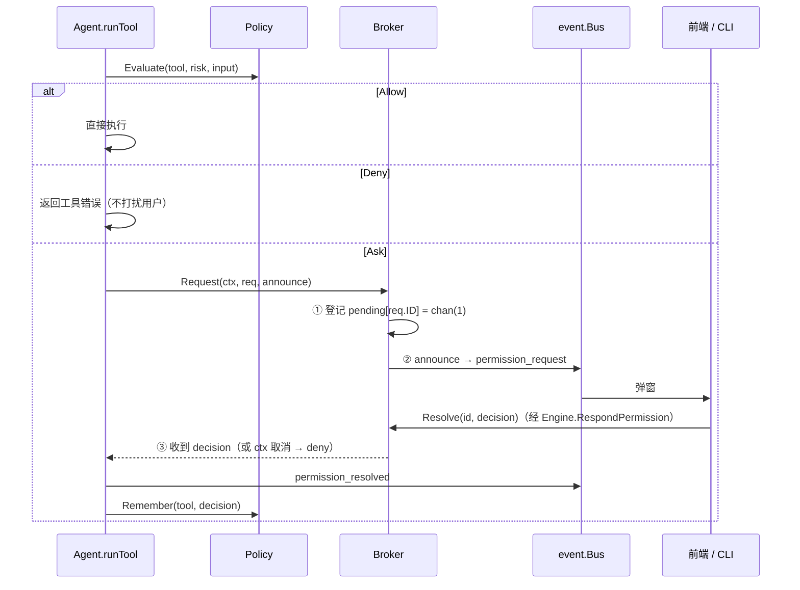

# 设计：工具与权限（internal/tool、internal/permission）

## 目标

- 工具作者只关心"做什么"，不关心 UI 和权限流程；
- 危险操作（写文件、执行命令）在执行前必须得到用户确认；
- 确认过程不依赖任何具体 UI，内核可以在测试里被"自动应答"驱动。

## 工具接口

```go
type Tool interface {
    Spec() Spec                             // 名称、描述、JSON Schema、风险等级
    Summarize(input json.RawMessage) string // 一句人话，用于权限弹窗和卡片标题
    Execute(ctx context.Context, call Call) Result
}
```

- **风险等级由工具声明**（`read` / `write` / `exec`），是否需要确认由策略决定。
- **失败用 `Result{IsError: true}` 表达**，而不是 Go error：模型需要看到失败原因才能调整。
- **JSON Schema 手写**：schema 是写给模型看的"文档"，手写能精确控制措辞；反射生成还需要额外依赖。
- **`Summarize` 由工具实现**：只有工具知道哪个参数是关键信息（路径、命令）。

### 内置工具

| 工具 | 风险 | 说明 |
| --- | --- | --- |
| `read_file` | read | 拒绝二进制文件；输出超过 32KB 截断并注明 |
| `list_dir` | read | 不递归（让模型按需逐层查看，节省上下文） |
| `write_file` | write | 覆盖写入，自动创建父目录 |
| `shell` | exec | `sh -c`（Windows 为 `cmd /C`），工作区为 cwd，默认 60 秒超时，取消时杀进程组 |

所有路径通过 `resolvePath` 限制在工作区内（拒绝 `..`、工作区外的绝对路径，以及经符号链接指向工作区之外的路径）。**这只是防误操作，不是安全沙箱**——shell 工具可以做任何事，这正是它每次都需要确认的原因；检查与使用之间的竞态（TOCTOU）也没有处理。

## 权限：策略 + 会合点



### 策略（Policy）

内置的 `ModePolicy` 有三种模式：

| 模式 | read | write | exec |
| --- | --- | --- | --- |
| `default` | 放行 | 询问 | 询问 |
| `auto` | 放行 | 放行 | 放行 |
| `readonly` | 放行 | 拒绝 | 拒绝 |

用户选择"本会话总是允许"（`allow_session`）后，同名工具在本会话内不再询问；`NewSession` / `LoadSession` 时 `Reset`。未知模式回落到 `default`——宁可多问一次。

`Policy` 是接口，`Evaluate` 已经接收工具参数，以后可以实现更细的规则（如允许 `go test`、拒绝 `rm -rf`，或按路径白名单）。

### 会合点（Broker）

问题：agent 的 goroutine 要停下来等；回答从另一个 goroutine（Wails 方法调用 / CLI 读 stdin）到来。

解法：每个请求一个**容量为 1** 的 channel。

- **先登记后通知**：如果先发事件再登记，一个"秒回"的界面（测试、`-yes` 的 CLI 在回调里同步回复）可能在登记之前调用 `Resolve`，得到"未知请求"，agent 永远等不到回答。
- **容量为 1**：`Resolve` 永远不会阻塞，即使它在 `announce` 回调内部被同步调用。
- **取消**：`select` 同时等 channel 和 `ctx.Done()`；取消按拒绝处理。
- **重复回复**返回 `ErrUnknownRequest`；非法决定字符串返回错误（避免拼写错误被当成拒绝）。

## 执行顺序

一条 assistant 消息里的多个工具调用**顺序执行**。并行更快，但多个确认弹窗同时出现会让人困惑；对四个内置工具也没有明显收益。以后可以只对 `read` 风险的工具并行。

## 考虑过的其他方案

- **工具自己弹窗/自己判断是否需要确认**：每个工具都要依赖 UI，且策略分散，无法统一切换"只读模式"。
- **权限请求用回调直接问 UI（`Approver` 接口）**：等价于把 Broker 实现在 UI 里；放在 permission 包里则 CLI、Wails、测试共享同一个实现。
- **把"本会话允许"记在前端**：后端不知道就还会发请求，前端还得自动回复，绕了一圈。

## 测试

- `permission_test.go`：三种模式、会话记忆、在通知回调里同步回复、跨 goroutine 回复、取消、非法决定。
- `builtin_test.go`：读写列、路径逃逸、截断、二进制、非法参数、shell 退出码 / 工作目录 / 超时杀进程。
- `core/engine_test.go`：拒绝后继续、会话内允许只问一次、等待确认时取消。
